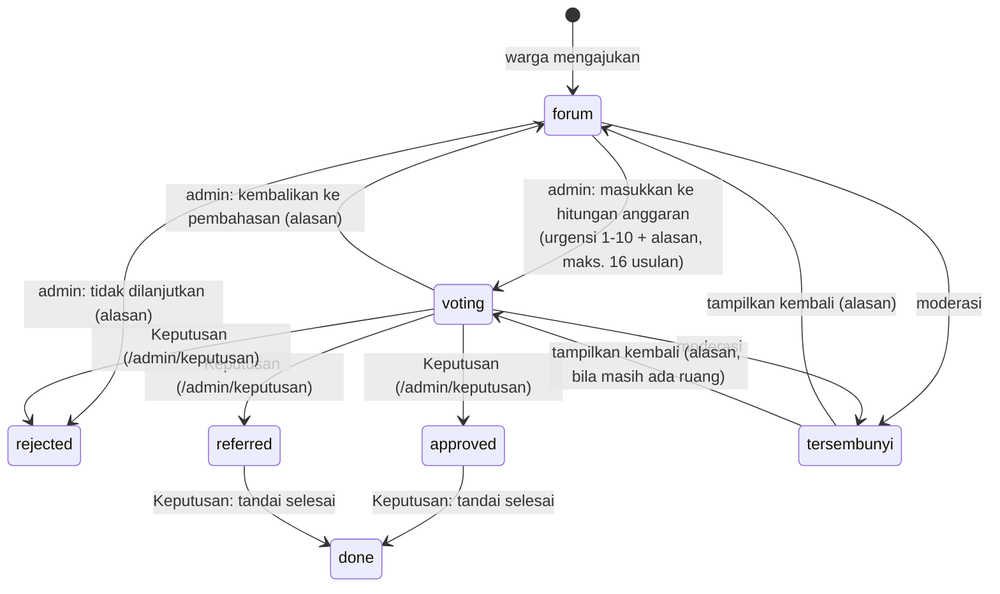
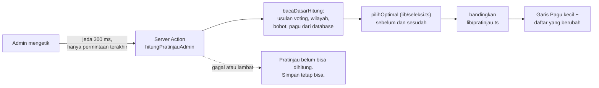

# Halaman admin desa

Halaman admin menutup siklus usulan SUARA. Sebelumnya usulan warga berhenti di status `forum`, pagu tertanam
di kode, bobot hanya bisa diubah lewat SQL, dan akun hanya bisa dibuat lewat skrip terminal. Sekarang
perangkat desa bisa meninjau usulan, mengatur pagu dan bobot, mengelola akun warga, dan memoderasi, dengan
**pratinjau dampak** pada Garis Pagu sebelum keputusan pagu, bobot, atau perpindahan status berlaku. Untuk cara mencobanya, lihat
[README](../README.md#admin-desa). Untuk bahasa visual, lihat [DESIGN.md](../DESIGN.md).

- [Hak admin dan batasannya](#hak-admin-dan-batasannya)
- [Siklus status](#siklus-status)
- [Rubrik urgensi](#rubrik-urgensi)
- [Pratinjau dampak](#pratinjau-dampak)
- [Jejak publik dan jejak admin tertutup](#jejak-publik-dan-jejak-admin-tertutup)
- [Admin bersamaan dan batas 16 usulan](#admin-bersamaan-dan-batas-16-usulan)
- [Akun](#akun)
- [Cache](#cache)
- [Keamanan dan privasi](#keamanan-dan-privasi)
- [Pengujian](#pengujian)
- [Keputusan yang diambil sendiri](#keputusan-yang-diambil-sendiri)
- [Keterbatasan yang diketahui](#keterbatasan-yang-diketahui)
- [Pekerjaan berikutnya](#pekerjaan-berikutnya)

## Hak admin dan batasannya

| Bagian | Yang bisa dilakukan | Alamat |
|---|---|---|
| Ringkasan | Melihat pekerjaan yang menunggu: usulan belum ditinjau, hitungan anggaran, akun yang belum mengganti kata sandi, komentar baru | `/admin` |
| Usulan | Menyaring semua usulan; memasukkan ke hitungan anggaran (dengan urgensi dan alasan), tidak melanjutkan, atau mengembalikan ke pembahasan | `/admin/usulan`, `/admin/usulan/[id]` |
| Anggaran | Mengubah pagu dan bobot dengan alasan, melihat riwayatnya | `/admin/anggaran` |
| Akun | Membuat akun warga, mengatur ulang kata sandi, menonaktifkan dan mengaktifkan kembali | `/admin/akun`, `/admin/akun/baru`, `/admin/akun/[id]` |
| Moderasi | Menyembunyikan komentar, menampilkan kembali konten yang disembunyikan | `/admin/moderasi` |

Semua orang yang bukan admin aktif mendapat halaman "Halaman ini khusus admin desa" (bukan pengalihan
diam-diam); yang belum masuk dialihkan `proxy.ts` ke `/masuk?lanjut=...`.

**Yang sengaja tidak bisa dilakukan admin, dan alasannya:**

- **Membuat akun admin dari antarmuka.** Akun admin hanya lewat `npm run akun:buat`, yang butuh akses terminal.
  Kalau sesi admin bocor, penyerang tidak bisa melahirkan admin baru yang bertahan setelah sesinya dicabut.
  Fungsi SQL `buat_akun_warga` hanya membuat peran `warga`; tidak ada masukan peran sama sekali.
- **Menonaktifkan akunnya sendiri**, dan **menonaktifkan admin aktif terakhir.** Desa harus selalu punya
  setidaknya satu admin yang bisa masuk. Pemeriksaan "admin terakhir" di `atur_aktif` melindungi dari dua
  admin yang saling menonaktifkan bersamaan (kunci advisory membuat keduanya berurutan).
- **Mengatur ulang kata sandinya sendiri.** Gunakan `/akun`, yang meminta kata sandi lama.
- **Menetapkan hasil musyawarah** (`voting → approved/referred/rejected`, `approved/referred → done`) dari halaman
  Usulan. Itu dikerjakan di bagian **Keputusan** (`/admin/keputusan`), yang punya konsep periode anggaran; lihat
  [keputusan.md](keputusan.md).
- **Mengubah aturan dukungan.** Aturannya masih sementara; lihat [forum.md](forum.md#aturan-dukungan-sementara).

## Siklus status

Tiga perpindahan di fitur ini semuanya wajib beralasan, dan aturannya ada di **satu tempat yang
menentukan**: fungsi SQL `pindahkan_status` ([0005_admin.sql](../supabase/migrations/0005_admin.sql)).
[lib/transisi-status.ts](../lib/transisi-status.ts) hanya menentukan tombol apa yang ditampilkan.

- **`forum → voting`**: urgensi 1 sampai 10 dan alasan urgensi (20 sampai 500 karakter). Alasan urgensi
  sekaligus menjadi alasan keputusan, satu kalimat yang dibaca warga, bukan dua kolom yang saling mengulang.
  Nama singkat (label batang anggaran) boleh diubah; kosong berarti memakai yang ada.
- **`forum → rejected`** ("Tidak dilanjutkan"): urgensi tetap kosong. Batasan
  `proposals_urgensi_wajib_setelah_forum` dilonggarkan untuk `rejected` karena usulan yang ditolak sebelum
  dinilai tidak boleh dipaksa dinilai hanya untuk ditolak. `voting`, `approved`, dan `done` tetap wajib bernilai.
  Antarmuka menulis "Tidak dilanjutkan" (bukan "Ditolak") untuk usulan seperti ini di halaman admin.
- **`voting → forum`**: urgensi **dikosongkan**. Usulan yang kembali dibahas belum punya nilai yang berlaku,
  dan halaman forum berkata jujur "Urgensi belum dinilai". Nilai sebelumnya tidak hilang: tercatat di jejak
  (`detail.urgensi_sebelumnya`). Memasukkannya lagi menuntut penilaian baru dengan alasan baru.

## Rubrik urgensi

Urgensi adalah satu-satunya komponen skor yang dinilai manusia. Tanpa pegangan, dua usulan yang setara bisa
mendapat nilai berjauhan hanya karena dinilai pada hari yang berbeda. Rubrik ([lib/urgensi.ts](../lib/urgensi.ts))
sengaja berisi **empat tingkat, bukan sepuluh**: admin memilih tingkat dulu, lalu angka di dalamnya.

| Nilai | Tingkat | Artinya |
|---|---|---|
| 1–3 | Bisa menunggu periode berikutnya | Mempercantik atau merawat tampilan. Layanan dasar dan keselamatan warga tidak terganggu. |
| 4–6 | Mengganggu kegiatan sehari-hari | Warga masih bisa beraktivitas, tetapi dengan susah payah atau sering terhambat. |
| 7–8 | Merugikan banyak warga bila ditunda | Kerugian terjadi setiap hari atau setiap musim, dan dirasakan banyak warga. |
| 9–10 | Menyangkut keselamatan | Ada risiko cedera atau kehilangan nyawa. 10 untuk bahaya yang paling dekat dan paling berat. |

Tingkat yang sesuai dengan angka terpilih ditebalkan dan digarisbawahi (bukan hanya warna). Nilai di data
demo mengikuti rubrik ini: Gapura 3 (tampilan), Jalan SDN 03 8 (merugikan setiap hari), Talud 10 (keselamatan).
Tidak ada nilai bawaan: angka harus dipilih, supaya penilaian tidak terjangkar pada angka yang sudah terisi.

**Saran urgensi AI** muncul di samping kelompok urgensi (`SaranUrgensi` di `FormPindahStatus`, prop `saranAktif`) **hanya bila**
`GEMINI_API_KEY` terpasang dan usulannya usulan warga berstatus forum. Tanpa kunci formulir ini persis seperti sebelumnya, tanpa label
"AI" atau tombol (klaim di antarmuka hanya boleh ada bila fiturnya ada, [PRODUCT.md](../PRODUCT.md) prinsip 3). Cara kerjanya
ada di [saran-urgensi.md](saran-urgensi.md).

## Pratinjau dampak

Pembeda halaman admin SUARA dari panel admin biasa: **admin melihat akibat keputusannya pada anggaran sebelum
keputusan itu berlaku.** Pratinjau tampil otomatis begitu isiannya valid, untuk perubahan pagu, perubahan bobot,
`forum → voting`, dan `voting → forum`.

Isinya: dua batang Garis Pagu ("Sekarang" dan "Sesudah disimpan", komponen `PaguBar` yang sama dengan halaman
utama, varian ringkas), ringkasan satu baris, kalimat khusus untuk perpindahan status, dan daftar usulan yang berubah
status dengan `StatusLabel` sebelum dan sesudah. Usulan yang tidak berubah dilipat. Bentuk kalimatnya (contoh
dari komentar [lib/pratinjau.ts](../lib/pratinjau.ts), bukan angka dari data nyata): "2 usulan berubah status.
Sisa pagu Rp 12 juta menjadi Rp 40 juta." dan "Jika dimasukkan dengan urgensi 8, usulan ini berada di peringkat 3
dari 8 rekomendasi: Terbiayai. Lampu PJU RW 07 bergeser menjadi Ditunda."

**Tidak ada rumus baru.** Pratinjau memakai `pilihOptimal`, kembaran TypeScript dari `pilih_optimal` di SQL.
Logika pembandingnya ([lib/pratinjau.ts](../lib/pratinjau.ts)) adalah fungsi murni tanpa akses database dan
tanpa `server-only`, jadi dipakai juga oleh halaman [`/simulasi`](simulasi.md) (warga bermain dengan pagu dan bobot tanpa
menyimpan). Tampilan perbandingannya diekstrak dari `PratinjauDampak` menjadi
[`PerbandinganPagu`](../components/anggaran/PerbandinganPagu.tsx) (label lewat props); `PratinjauDampak` sendiri tetap
terikat ke Server Action admin (hitungan dan jeda 300 ms ada di situ), dan tampilan serta perilakunya di halaman admin tidak
berubah. Satu perbaikan ikut: `HasilBanding.masuk` kini berupa daftar (sebelumnya hanya satu usulan, dan yang terakhir
menimpa yang lain); kalimat untuk satu usulan yang dipakai admin tidak berubah.

**Bukti bahwa hasilnya sama dengan halaman utama.** `supabase/tests/admin.test.ts`, bagian kesetaraan pratinjau:
satu tes keadaan awal ("Sekarang" sama dengan `rekomendasi_resmi`) dan empat tes kombinasi yang menjalankan enam
perbandingan. Tiap perbandingan menghitung pratinjau dari data database **sebelum** menyimpan, menyimpan perubahan
lewat fungsi SQL yang sesungguhnya, lalu membandingkan `rekomendasi_resmi` baris demi baris (urutan, peringkat,
terpilih, skor, total berjalan) dengan `pilihOptimal` pada keadaan baru, ditambah batang "Sesudah disimpan" dan sisa
pagunya dengan yang benar-benar terbiayai.

| Tes | Perbandingan di dalamnya |
|---|---|
| Kombinasi 1 | bobot 20/60/20 |
| Kombinasi 2 | pagu Rp 400 juta |
| Kombinasi 3 | bobot 70/10/20, lalu pagu Rp 250 juta |
| Kombinasi 4 | memasukkan usulan forum dengan urgensi 8, lalu mengembalikannya ke forum |

Satu hal yang dijaga supaya seri (skor dan dukungan sama persis) diputus sama dengan SQL: urutan usulan
`created_at`, lalu `id` ([`UsulanHitung.dibuat`](../lib/pratinjau.ts)).

## Jejak publik dan jejak admin tertutup

| Peristiwa | Jejak publik (`accountability_logs`) | Jejak admin tertutup (`jejak_admin`) |
|---|---|---|
| Memasukkan, tidak melanjutkan, mengembalikan usulan | `status_change`, pencatat = **nama pengguna admin**, dengan alasan | – |
| Mengubah pagu | `budget_change` (jenis baru), pencatat = nama pengguna admin, dengan alasan | – |
| Mengubah bobot | `weight_change`, pencatat = nama pengguna admin, angka lama dan baru, alasan | – |
| Menyembunyikan atau menampilkan kembali konten | `moderation`, pencatat = **"admin"** | siapa yang melakukannya |
| Membuat akun, mengatur ulang kata sandi, menonaktifkan, mengaktifkan | **tidak ada** | siapa, siapa sasarannya, kapan |
| Warga mengganti kata sandinya | tidak ada | pemilik akun, kapan |

**Kenapa dipisah.** Prinsip produk: setiap keputusan *anggaran* punya alasan yang bisa dibaca warga, jadi
pelakunya pun tertulis. Perubahan *akun* menyangkut data pribadi (nama lengkap, nomor warga), jadi catatannya
tertutup dan tidak pernah dibaca halaman publik. Jejak tertutup juga tidak pernah memuat kata sandi atau hash
(teruji).

**Moderasi tetap menulis "admin"** di jejak publik, mengikuti keputusan forum yang sudah ada (melindungi perangkat
desa dari tekanan atas satu keputusan moderasi). Yang baru: nama akunnya kini tercatat di jejak tertutup, dan
ditampilkan di halaman Moderasi ("Disembunyikan [waktu] oleh [nama pengguna]. Alasan: ..."). Bila musyawarah ingin pencatat moderasi terbuka
juga, ubah dua string `'admin'` di `sembunyikan` dan `tampilkan_kembali`.

**Log bobot kini jujur soal pelakunya.** Trigger lama menulis pencatat `'admin'` tertanam. Pencatatan tetap di
**satu tempat** (trigger `trg_log_perubahan_bobot`, jadi perubahan lewat SQL Editor pun tercatat), tetapi trigger
sekarang membaca pelaku dan alasan dari `set_config('suara.pelaku' / 'suara.alasan', ..., true)` yang diisi
`ubah_bobot`. Nilai lokal transaksi itu hilang saat transaksi selesai dan dikosongkan lagi di akhir fungsi
(teruji: perubahan SQL berikutnya tetap tercatat dengan pencatat "admin" seperti dulu).

## Admin bersamaan dan batas 16 usulan

**Versi, bukan menimpa diam-diam.** `pengaturan_anggaran` dan `scoring_weights` punya kolom `versi`. Formulir
membawa versi yang dibacanya; `ubah_pagu` dan `ubah_bobot` mengunci barisnya dan menolak bila versinya sudah
berubah, dengan nilai terbaru dan jam perubahan: "Pagu sudah diubah admin lain pada 14:05 WIB. Muat ulang untuk
melihat nilai terbaru." Layar menampilkan nilai terbaru **di samping** nilai yang diketik, dengan tombol "Muat
ulang nilai terbaru". Dipilih bilangan bulat, bukan `updated_at`: stempel waktu yang melewati JSON kehilangan
presisi mikrodetiknya, sehingga perbandingannya bisa meleset. Perpindahan status memakai cara yang sama:
`p_status_dibaca` harus masih sama dengan status sekarang.

**Batas 16.** `pilih_optimal` mencoba semua kombinasi (2ⁿ) dan menolak lebih dari 16 usulan `voting`; usulan
ke-17 yang dibiarkan masuk akan membuat halaman utama galat. Karena itu batas dijaga di database, dengan kunci
advisory supaya dua admin yang memindahkan usulan berbeda tidak sama-sama lolos hitungan:

- `pindahkan_status` menolak `forum → voting` bila sudah ada 16 (kode `batas_voting`).
- `tampilkan_kembali` menolak menampilkan usulan `voting` yang akan membuat jumlahnya 17.
- Usulan tersembunyi tidak dihitung terhadap batas (tidak ikut skor).
- Antarmuka menjelaskannya **sebelum** tombol ditekan: tombol "Masukkan ke hitungan anggaran" diganti penjelasan
  dan tautan ke daftar usulan `voting`.

## Akun

- **Membuat akun warga** (`/admin/akun/baru`, empat langkah): pilih warga (pencarian nama atau nomor; hanya yang
  belum punya akun), nama pengguna (saran dari nama, dicek ketersediaannya), kata sandi awal, hasil.
  Pencarian memakai daftar hasil dengan tombol "Pilih", bukan *combobox* ARIA: lebih andal untuk pembaca layar.
- **Kata sandi awal** dibuat server (12 karakter dari 31 simbol, sekitar 59 bit, tanpa `l 1 i o 0`, mis.
  `k7mq-w3pa-hx8t`, mudah dibacakan) atau diketik admin menurut `periksaKataSandiBaru`. Ditampilkan **sekali**.
  Di-hash di server dengan `hashKataSandi`; yang dikirim ke database hanya hash. Bentuk aslinya hanya ada di
  variabel lokal Server Action dan di memori komponen layar hasil: tidak masuk URL, `sessionStorage`,
  `localStorage`, log server, atau cache (teruji). Memasang ulang komponen saat dialog ditutup membuang sisanya.
- **Batas laju** pembuatan akun: 30 per jam per admin. Satu admin yang bekerja wajar membuat puluhan akun
  sehari, bukan ratusan dalam hitungan menit; batas ini membuat sesi admin yang bocor tidak bisa membuat akun
  massal untuk menggelembungkan dukungan sebelum ketahuan.
- **Wajib ganti kata sandi.** Akun yang dibuat atau diatur ulang admin bertanda `harus_ganti_sandi`; setelah
  masuk, mereka diarahkan ke `/akun` dengan penjelasan. Mengganti kata sandi memverifikasi kata sandi lama lewat
  mesin login yang sama (percobaan salah ikut dihitung dan dikunci), mencabut sesi di perangkat lain (naikkan
  `versi_sesi`), dan menerbitkan ulang sesi perangkat ini.
- **Menonaktifkan dan atur ulang** naikkan `versi_sesi`: semua sesi akun itu langsung tidak berlaku. Teruji
  ujung ke ujung (warga yang dinonaktifkan tidak bisa lagi membuka `/akun`).

> **Cacat yang ditemukan dan diperbaiki di sini.** Sesi yang tokennya masih sah tetapi akunnya sudah tidak
> berlaku membuat `/akun` dan `/masuk` saling mengalihkan tanpa henti: `proxy.ts` hanya membaca tanda tangan
> token, jadi ia mengembalikan `/masuk` ke `/akun`, sementara `/akun` memeriksa database dan mengalihkan balik.
> Sekarang `wajibMasuk()` mengarahkan ke `/masuk?sesi=berakhir`, yang tidak dialihkan proxy dan menjelaskan
> bahwa sesinya sudah berakhir.

## Cache

Halaman utama dan forum memakai `'use cache'`. Setiap aksi admin yang mengubah angka publik memanggil
`updateTag` untuk `beranda`, `forum`, `pengaturan` (tag baru), dan `usulan:<id>` yang terdampak, jadi admin
langsung melihat hasilnya di halaman publik (teruji). Posisi anggaran satu usulan bergantung pada usulan lain,
pagu, dan bobot, jadi `muatUsulan` kini ikut ber-tag `beranda` dan `pengaturan`.

Halaman admin sendiri **tidak pernah** memakai `'use cache'` dan **tidak pernah** memakai data cadangan:
datanya pribadi dan keputusan anggaran tidak boleh diambil dari data basi. Bila database tidak terjangkau,
`app/admin/error.tsx` menampilkan penjelasan dan tombol "Coba lagi", tanpa aksi yang bisa ditekan.

## Keamanan dan privasi

- **Semua mutasi lewat Server Action** (`app/admin/aksi.ts`, `app/akun/aksi.ts`). Tiap aksi memeriksa sesi dan
  peran sendiri, memvalidasi ulang semua masukan (panjang, pola, enum, rentang, UUID) dengan skema yang sama
  dengan klien, dan meneruskan id admin **dari sesi** ke fungsi SQL, yang memeriksa lagi bahwa akun itu admin
  aktif. Id akun, peran, dan `warga_id` tidak pernah dipercaya dari formulir. Sesi habis dikembalikan sebagai
  galat `belum_masuk`, bukan pengalihan, supaya isian tidak hilang.
- **Pembaca data** (`lib/admin-data.ts`) masing-masing menolak pemanggil yang bukan admin: lapisan kedua setelah
  pemeriksaan di setiap halaman (bukan hanya di proxy).
- **Fungsi SQL** hanya bisa dipanggil `service_role` (`revoke execute ... from public, anon, authenticated`);
  teruji untuk setiap fungsi, termasuk bahwa `anon` benar-benar ditolak. RLS aktif di tabel baru tanpa policy.
  View admin (`security_invoker`) kosong bagi `anon` (teruji).
- **Data pribadi.** Nama lengkap dan nomor warga hanya ada di respons halaman admin. Jejak publik tidak pernah
  memuat data akun. Komentar di moderasi hanya nama depan dan RW, seperti di forum.
- **XSS.** Teks pengguna hanya dirender sebagai teks React. Pesan konfirmasi dibawa lewat URL sebagai kode dari
  daftar tertutup ditambah UUID, bukan teks: tautan yang dibagikan tidak bisa memunculkan kalimat apa pun.
- **CSRF.** Pemeriksaan Origin bawaan Server Actions; tidak ada `route.ts` untuk mutasi.
- **Galat database** dicatat di server tanpa data pribadi dan tanpa kata sandi.

## Pengujian

| Jenis | Cakupan |
|---|---|
| Unit (`npm test`) | Pratinjau dan pembanding, validasi pagu/bobot/urgensi, transisi status, rubrik, nama pengguna, kata sandi acak, filter dan paginasi, ringkasan, pesan konfirmasi |
| SQL di PGlite (`supabase/tests/admin.test.ts`, 90 tes) | Migrasi 0001–0005 + kedua seed. `rekomendasi_resmi(300000000)` sama persis dengan baseline; setiap fungsi menolak non-admin, admin nonaktif, dan akun yang tidak ada; `anon` tanpa hak `execute`; transisi tidak sah, status yang dibaca sudah berubah, usulan ke-17, bentrok versi; log dengan jenis, pencatat, dan detail yang benar; akun menulis `jejak_admin` dan **tidak** menulis log publik; satu warga satu akun; diri sendiri; versi sesi naik; kesetaraan pratinjau dengan `rekomendasi_resmi` |
| E2E + axe (`npm run e2e`, proyek `admin`) | Alur lengkap di Chromium dengan build produksi (admin masuk, usulan masuk hitungan dengan pratinjau, halaman utama dan forum langsung berubah, bobot, pagu dan bentrok versi, akun baru sampai dinonaktifkan, moderasi); axe tanpa pelanggaran di semua halaman di 360 dan 1440 px termasuk dialog, galat, pratinjau, dan tiap langkah membuat akun; keyboard, reflow 320 px, target sentuh 44 px, spasi teks WCAG 1.4.12 |

Cara memeriksa migrasi setelah dijalankan di Supabase ada di [README](../README.md#menyiapkan-database).

## Keputusan yang diambil sendiri

Hal-hal yang brief tidak menentukan, dan pilihan yang diambil:

1. **Rentang pagu Rp 10 juta sampai Rp 10 miliar** (sesuai saran brief). Di bawah itu tidak ada usulan yang
   masuk akal terbiayai; di atas itu jauh di atas desa mana pun, dan menangkap salah nol.
2. **Pagu hanya satu nilai yang berlaku** (`pengaturan_anggaran`, satu baris), dengan `PAGU_DEFAULT` hanya sebagai
   cadangan halaman publik.
3. **`voting → forum` mengosongkan urgensi** (alasan di bagian [Siklus status](#siklus-status)).
4. **Alasan urgensi = alasan keputusan** untuk `forum → voting` (satu alasan yang dibaca warga).
5. **Batasan urgensi dilonggarkan untuk `rejected`** (satu-satunya perubahan pada skema lama selain kolom baru).
6. **Jenis log baru `budget_change`** (bukan `note`), supaya riwayat pagu bisa dibaca per jenis dan tampil
   berlabel "Pagu diubah" di halaman utama. Entri pagu awal dari `seed.sql` dikategorikan ulang oleh migrasi.
7. **Tinjau usulan adalah halaman tersendiri** (`/admin/usulan/[id]`), bukan dialog: formulir urgensi, rubrik, dan
   pratinjau butuh ruang, dan halaman memberi tombol kembali dan tautan yang bisa dibagikan di ponsel. Hanya aksi
   pendek ("Tidak dilanjutkan", "Kembalikan", akun, moderasi) memakai dialog.
8. **Detail akun juga halaman tersendiri** (`/admin/akun/[id]`), supaya daftar tidak memuat puluhan dialog dan
   jejak admin per akun punya tempat.
9. **Atur ulang kata sandi selalu acak.** Admin tidak mengetik kata sandi untuk orang lain; ia hanya
   menyampaikannya.
10. **Posisi anggaran di tabel usulan** ditulis ringkas ("Peringkat 3 dari 7" + status) tanpa keterangan panjang
    forum, supaya baris tidak membengkak. Datanya sama.
11. **Pesan konfirmasi lewat URL** (`?berhasil=kode&id=uuid`) setelah pengalihan, dengan kalimat yang disusun
    sisi server dari daftar tertutup.
12. **Pita mode admin** gelap (tinta, teks putih) dengan cap perisai biru yang sama dengan label "Admin desa"
    di forum, dibalik supaya terbaca. Itu satu-satunya permukaan gelap di halaman admin.
13. **Moderasi tetap "admin" di jejak publik** (lihat [Jejak publik dan jejak admin tertutup](#jejak-publik-dan-jejak-admin-tertutup)).
14. **Proyek Playwright `admin` berjalan sesudah proyek `publik`**: tes admin mengubah data dan cache publik,
    dan setiap berkas me-reset database dengan id baru sementara cache Next masih memegang id lama.

## Keterbatasan yang diketahui

- **Belum diuji dengan pembaca layar** (NVDA, VoiceOver) dan perangkat sentuh nyata. axe, pemeriksaan keyboard,
  reflow, dan spasi teks otomatis tidak menggantikannya. Hal yang paling perlu didengar: pengumuman pratinjau
  dan penunjuk jumlah bobot (sengaja ditunda 0,3 sampai 0,6 detik), serta dialog hasil kata sandi.
- **E2E memakai tiruan PostgREST** di atas PGlite, bukan Supabase sungguhan; kecocokan dengan PostgREST asli
  tidak ikut terverifikasi. Migrasi 0005 belum dijalankan di Supabase milik pemilik proyek (aturan proyek).
- **Daftar dibaca utuh lalu dipotong di server** (maksimal 500 usulan, 1.000 akun, 500 komentar), seperti forum.
  Cukup untuk ukuran desa; lebih dari itu perlu paginasi di sisi database.
- **Pratinjau dihitung ulang dari database tiap permintaan** dan `pilihOptimal` mencoba 2ⁿ kombinasi (maks.
  65.536). Cepat untuk 16 usulan; diukur di mesin pengembangan, belum di hosting nyata.
- **Pemeriksaan "admin aktif terakhir"** tidak terjangkau lewat satu panggilan berurutan (pemanggil sendiri
  admin aktif, dan aturan diri-sendiri sudah menjaganya); ia ada untuk dua admin yang saling menonaktifkan
  bersamaan, dan tidak ada tes yang bisa menyela dua transaksi di PGlite satu koneksi.
- **Daftar usulan di ponsel panjang**: satu baris tabel sekitar 435 px tingginya di lebar 360 px (diukur dari
  tangkapan layar). Pasangan label-nilai dua kolom sudah menekannya, tetapi desa dengan ratusan usulan
  akan tetap bergulir jauh; pencarian, filter, dan paginasi 25 baris sudah tersedia.
- **Aturan dukungan masih sementara**; tidak ada pengaturannya di sini.
- **Migrasi dan kode harus dipasang bersamaan.** Kode baru membaca `harus_ganti_sandi` pada login dan
  `pengaturan_anggaran` pada beranda; menjalankan kode sebelum `0005_admin.sql` membuat login gagal. Jalankan
  SQL lebih dulu.

## Pekerjaan berikutnya

1. ~~**Fitur Keputusan**~~ selesai: penetapan hasil musyawarah ada di bagian Keputusan (`/admin/keputusan`), bukan di
   halaman Usulan; lihat [keputusan.md](keputusan.md). Navigasi admin kini berisi enam bagian (Ringkasan, Usulan, Anggaran,
   Keputusan, Akun, Moderasi), dan filter Usulan punya "Sudah diputuskan".
2. ~~**Saran urgensi oleh AI**~~ sudah ada (opsional, butuh kunci Gemini): lihat [saran-urgensi.md](saran-urgensi.md). Yang belum: kalibrasi dengan Gemini sungguhan.
3. **Data wilayah**: penduduk dan anggaran periode lalu belum bisa diubah dari antarmuka.
4. **Jatah dukungan**: putuskan aturannya (lihat [forum.md](forum.md#aturan-dukungan-sementara)).
5. **Uji dengan pembaca layar**, lalu E2E melawan PostgREST/Supabase sungguhan di proyek uji.
6. ~~Halaman `/simulasi`~~ sudah ada: lihat [simulasi.md](simulasi.md).

Brief fitur ada di [docs/prompts/](prompts/): `keputusan.md`, `saran-urgensi.md`, dan `simulasi.md` sudah dikerjakan.
