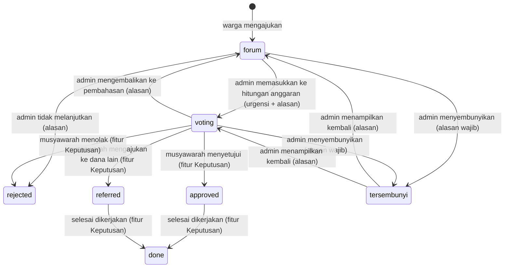
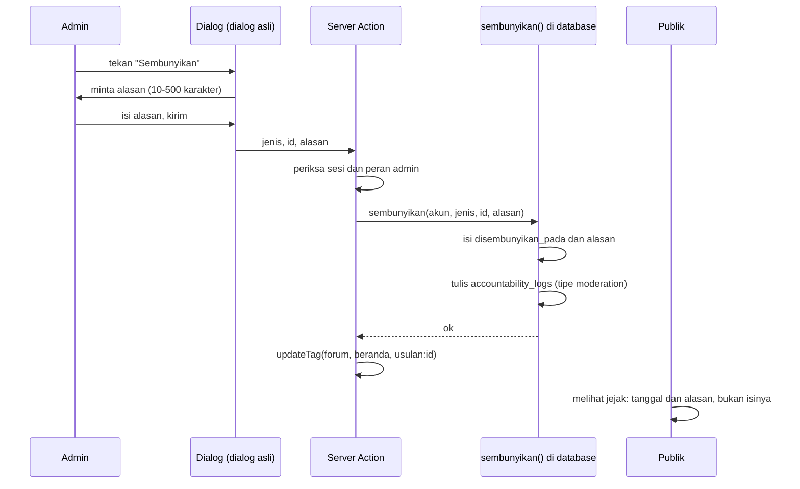
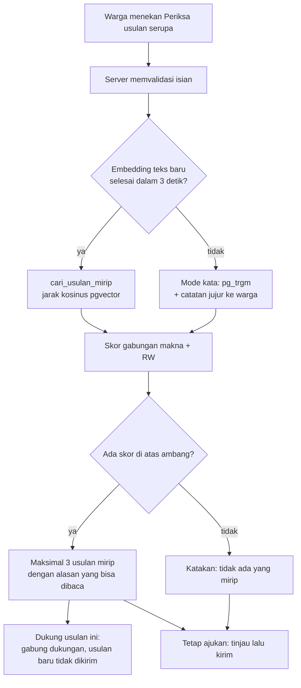

# Forum warga

Forum adalah langkah 1 dari "Cara kerja" di halaman utama: warga menyampaikan aspirasi. Dokumen ini
menjelaskan aturan, alur, dan keputusan teknis di baliknya. Untuk cara mencobanya, lihat
[README](../README.md#forum-warga). Untuk bahasa visual, lihat [DESIGN.md](../DESIGN.md).

- [Yang bisa dilakukan siapa](#yang-bisa-dilakukan-siapa)
- [Aturan dukungan (sementara)](#aturan-dukungan-sementara)
- [Siklus status dan moderasi](#siklus-status-dan-moderasi)
- [Deteksi usulan mirip](#deteksi-usulan-mirip)
- [Batas laju dan batas isian](#batas-laju-dan-batas-isian)
- [Cache dan data cadangan](#cache-dan-data-cadangan)
- [Keamanan dan privasi](#keamanan-dan-privasi)
- [Pengujian](#pengujian)
- [Keterbatasan yang diketahui](#keterbatasan-yang-diketahui)
- [Pekerjaan berikutnya](#pekerjaan-berikutnya)

## Yang bisa dilakukan siapa

| | Pengunjung | Warga (punya `warga_id`) | Admin |
|---|---|---|---|
| Membaca usulan, komentar, riwayat, jejak moderasi | ya | ya | ya |
| Mendukung dan membatalkan dukungan | tidak (diarahkan masuk) | ya | tidak |
| Mengajukan usulan | tidak (diarahkan masuk) | ya | tidak |
| Berkomentar | tidak | ya | ya (berlabel "Admin desa") |
| Menyembunyikan usulan atau komentar | tidak | tidak | ya, dengan alasan wajib |

Akun dibuat admin, tidak ada pendaftaran mandiri, supaya satu orang tidak bisa membuat banyak akun
untuk menambah dukungan. Akun warga **harus tertaut** ke satu baris di tabel `warga`
(`akun.warga_id`). Akun yang belum tertaut boleh membaca dan berkomentar, tetapi tidak mendukung
dan tidak mengajukan usulan; layar menjelaskan alasannya dan meminta menghubungi admin.

## Aturan dukungan (sementara)

**Sekarang:** satu dukungan per usulan per warga. Warga boleh mendukung banyak usulan dan boleh
membatalkan. Usulan yang sudah diputuskan (`approved`, `rejected`, `done`) tidak bisa didukung
maupun ditarik dukungannya.

> **Aturan ini sementara.** Pemilik produk masih menimbang jatah terbatas, misalnya 3 dukungan per
> warga per periode. Putuskan sebelum karya dikumpulkan.

**Alasan memilih "bebas" untuk sementara:** paling mudah dipahami warga, dan kunci utama
`votes (proposal_id, warga_id)` sudah menjamin "satu per usulan" apa pun aturannya. Kekurangannya:
warga yang mendukung semua usulan tidak memberi sinyal prioritas.

**Rancangan supaya mudah diganti.** Aturannya hanya ada di dua tempat:

1. Fungsi SQL `dukung_usulan` dan `batal_dukung` di
   [supabase/migrations/0004_forum.sql](../supabase/migrations/0004_forum.sql): penentu yang
   sebenarnya dan tidak bisa dilewati. Jatah per periode cukup ditambahkan di sini (hitung
   `votes` milik warga dalam periode, tolak dengan kode galat baru).
2. [lib/aturan-dukungan.ts](../lib/aturan-dukungan.ts): hanya untuk menjelaskan keadaan di layar
   (tombol aktif, atau kalimat penjelasan). Bila jatahnya berubah, tambahkan keadaan baru di sini.

Tidak ada tempat lain yang tahu aturannya, dan tes SQL di `supabase/tests/forum.test.ts` menjadi
daftar periksa perilaku yang harus tetap benar.

## Siklus status dan moderasi



Tiga perpindahan pertama dan menampilkan kembali dikerjakan di [halaman admin](admin.md#siklus-status).

- **Usulan baru** langsung tampil dengan status `forum` ("Sedang dibahas"), dan pengusul otomatis
  memberi dukungan pertama (trigger `trg_dukungan_pengusul`). `urgency_score` sengaja kosong:
  warga tidak menilai urgensi usulannya sendiri. Aturan basis data: kosong hanya boleh selama
  status `forum` atau `rejected` (usulan yang tidak dilanjutkan admin tidak dipaksa dinilai,
  dilonggarkan di migrasi 0005); `voting`, `approved`, dan `done` wajib 1 sampai 10.
- **`forum` dan `voting`** tampil bersama di daftar, dengan filter status. Yang berstatus `voting`
  menampilkan posisinya pada rekomendasi, dari perhitungan yang sama dengan Garis Pagu.
- **`approved`, `referred`, `rejected`, `done`** tetap bisa dibuka, tetapi dukungannya ditutup. Komentar tetap
  boleh. Usulan yang sudah diputuskan menampilkan blok "Keputusan musyawarah" (hasil, alasan, tautan ke halaman tahunnya,
  dan catatan penyelesaian bila `done`); filter "Sudah diputuskan" memuat keempatnya. `referred` ("Diajukan ke dana lain")
  tertutup dari dukungan oleh pemeriksaan status yang sama; aturan dukungan tidak diubah.
- **Perpindahan `forum` ke `voting`** (dan penilaian urgensi) dikerjakan admin di
  `/admin/usulan/[id]`, dengan pratinjau dampak; lihat [admin.md](admin.md). Perpindahan ke
  `approved`, `referred`, `rejected` (hasil musyawarah), dan `done` dikerjakan di `/admin/keputusan`; lihat
  [keputusan.md](keputusan.md).

### Moderasi



- Isi komentar atau judul usulan yang disembunyikan **dikosongkan di view database** (`v_komentar`,
  `v_usulan`), bukan hanya di aplikasi: bisa jadi isi itulah yang tidak pantas. Yang tampil
  hanyalah "Disembunyikan oleh admin desa pada [tanggal]. Alasan: …".
- Usulan tersembunyi hilang dari daftar, tidak ikut skor (`skor_usulan` mengabaikannya), dan
  diskusinya ditutup. Halaman detailnya tetap ada.
- Pesan di jejak keputusan tidak memuat judul usulan atau isi komentar, dan hanya menulis
  pencatat "admin" (nama akun tidak dibuka di jejak publik; sejak migrasi 0005 nama akunnya
  tercatat di `jejak_admin` yang tertutup dan terbaca admin di halaman Moderasi).
- Entri moderasi ikut muncul di "Jejak keputusan" di halaman utama (tipe `moderation`,
  label "Moderasi").
- Admin bisa **menampilkan kembali** konten yang disembunyikan di `/admin/moderasi`, dengan alasan
  wajib (fungsi `tampilkan_kembali`, tercatat sebagai `moderation`). Usulan `voting` yang
  ditampilkan kembali ditolak bila hitungan anggaran sudah berisi 16 usulan.

## Deteksi usulan mirip

Tujuannya: sebelum usulan baru terkirim, tunjukkan usulan yang mirip (dari makna dan lokasi) dan
tawarkan **menggabungkan dukungan**, supaya suara warga tidak terpecah. Warga tidak pernah
diblokir: ada dua pilihan, "Dukung usulan ini" atau "Tetap ajukan usulan saya".



### Model

- **`Xenova/multilingual-e5-small`**, kuantisasi 8-bit, lewat `@huggingface/transformers` di server
  Node ([lib/embedding.ts](../lib/embedding.ts)). 384 dimensi, cocok dengan `proposals.embedding
  vector(384)`. Mengerti bahasa Indonesia.
- **Awalan `query: ` di kedua sisi.** Kartu model e5 menyebut awalan `query: ` untuk tugas
  simetris seperti kemiripan teks dan deteksi duplikat; `passage: ` hanya untuk dokumen yang
  dicari lewat pertanyaan. Dua usulan yang saling dibandingkan adalah kasus simetris.
- Teks yang di-embedding: judul + deskripsi, dirapikan spasinya, maksimal 1.200 karakter.
- `gte-small` bawaan Supabase tidak dipakai: modelnya terutama berbahasa Inggris, dan untuk
  usulan berbahasa Indonesia tidak ada alasan memilihnya.

**Diukur di mesin pengembangan** (Node 24, Windows, CPU):

| Hal | Hasil |
|---|---|
| Berkas model | 118 MB (tokenizer +17 MB), total cache 130 MB |
| Unduhan dan muat pertama | sekitar 10,7 detik |
| Muat dari cache disk | sekitar 0,8 detik |
| Inferensi satu teks (hangat) | 4 sampai 15 ms |

### Rumus skor gabungan

```
makna  = potong((kosinus - 0,82) / (0,94 - 0,82), 0, 1)
lokasi = 1 bila RW sama, 0 bila beda
skor   = 0,8 × makna + 0,2 × lokasi        tampil bila skor ≥ 0,7
```

Setara kosinus **≥ 0,895 bila RW sama** dan **≥ 0,925 bila RW berbeda**. Kode:
[lib/kemiripan.ts](../lib/kemiripan.ts) (murni, diuji di `lib/kemiripan.test.ts`).

Kenapa kosinus tidak dipakai langsung: embedding e5 memberi kosinus tinggi bahkan untuk dua teks
yang tidak berkaitan, sehingga skala mentahnya sempit. Pada data seed, pasangan yang tidak
berkaitan berada di 0,79 sampai 0,89 (median 0,837). Rentang 0,82 sampai 0,94 meregangkannya ke
0 sampai 1.

**Lokasi.** Yang dipakai adalah RW. Kolom `proposals.location` (PostGIS) ada tetapi belum diisi
siapa pun (peta di luar cakupan), jadi jarak titik tidak dihitung. Slot untuk jarak belum
dibuat agar tidak ada kode mati.

### Alasan yang bisa dibaca

Satu kalimat yang hanya menyebut hal yang benar-benar terukur: kata kunci yang sama, RW, dan
kategori, mis. *"Sama-sama menyebut “jalan” dan “lampu”, di RW yang sama, kategori sama
(infrastruktur)."* Bila tidak ada kata yang sama, mode embedding boleh mengatakan *"Maknanya
mirip, meski kata-katanya berbeda"*; mode kata tidak.

### Cara kalibrasi dan hasilnya

```bash
npm run kemiripan:kalibrasi              # laporan
npm run kemiripan:kalibrasi -- --grid    # cari parameter terbaik
npm run kemiripan:kalibrasi -- --hibrida # coba gabungan makna + kata
```

Skrip memuat seluruh migrasi dan seed di PGlite (bukan Supabase), mengisi embedding dengan model
sungguhan, lalu menjalankan fungsi SQL pada **21 kalimat uji** yang ditulis tangan:
9 parafrase usulan yang ada, 6 parafrase **tanpa kata kunci yang sama**, 5 usulan yang tidak
berkaitan, dan 1 jebakan (kata sama, maksud berbeda: "lampu hias untuk 17 Agustus"). Totalnya
18 pasangan yang seharusnya mirip.

Parameter dipilih dengan hukuman 3× untuk usulan salah dibanding target yang terlewat:
menyodorkan "usulan mirip" yang keliru lebih merusak kepercayaan daripada melewatkan satu
(warga tetap bisa mengajukan, jadi tidak ada yang diblokir). Hasilnya berupa dataran luas
(banyak kombinasi memberi nilai sama); dipilih yang di tengah dataran, bukan di tepinya.

| Ukuran | Hasil |
|---|---|
| Target yang muncul di 3 teratas | **12 dari 18** |
| Usulan salah yang ikut tampil | **0** |
| Kalimat tanpa target yang bersih | **6 dari 6** (termasuk jebakan) |
| Kosinus pasangan mirip (n=18) | median 0,902; minimum 0,819 |
| Kosinus pasangan tidak mirip (n=255) | median 0,837; p90 0,861; **maksimum 0,891** |

**Temuan yang perlu dibaca apa adanya:**

- Rentang kosinus pasangan mirip dan tidak mirip **bertumpang tindih** (0,86 sampai 0,89). Ambang
  yang ketat menjaga nol usulan salah, dengan harga beberapa target terlewat.
- Pada 6 kalimat **tanpa kata yang sama**, embedding menemukan **3 dari 7** target. Cadangan
  `pg_trgm` (kata) juga menemukan 3 dari 7 pada peringkat 1. **Pada data seed sekecil ini,
  embedding e5-small belum terbukti lebih unggul daripada pencocokan kata.** Keunggulannya baru
  terlihat bila ambang dilonggarkan dan salah tampil dibolehkan.
- Gabungan makna + kata (`--hibrida`) memberi 13 dari 18 dengan 0 salah (atau 15 dari 18 dengan
  1 salah): perbaikan tipis, belum sepadan dengan kerumitannya, jadi tidak dipakai.
- Data kalibrasi kecil (13 usulan, 21 kalimat). Angka ini bukti bahwa mekanismenya bekerja dan
  ambangnya masuk akal, bukan jaminan akurasi pada desa nyata. Ulangi kalibrasi bila usulan
  sungguhan sudah banyak.

### Cadangan dan kejujuran klaim

- **Batas waktu 3 detik** untuk embedding. Lewat dari itu (atau model gagal dimuat), pencarian
  turun ke `pg_trgm` + RW, dan layar berkata: *"Pemeriksaan ini hanya mencocokkan kata, bukan AI,
  karena pencarian makna sedang tidak bisa dipakai. Hasilnya bisa kurang tepat."* Pemuatan model
  tetap berjalan di latar belakang, jadi permintaan berikutnya biasanya sudah memakai makna.
- **Label "AI" hanya tampil bila embedding benar-benar dipakai** (mode `ai`).
- **Usulan lama tanpa embedding** (skrip belum dijalankan, atau embedding gagal saat dikirim)
  tetap dinilai lewat kata dan diberi tahu ke warga ("n usulan lama belum diproses AI"). Tanpa
  ini mereka akan diam-diam terlewat dan warga salah diberi tahu "tidak ada yang mirip".
- **Pengisian embedding:** `npm run embedding:isi` mencetak SQL `update` (hanya membaca dari
  database); `-- --tulis` menulis langsung setelah mengetik `YA`. Usulan baru menyimpan embedding
  saat dikirim bila tersedia dalam 3 detik.

### Di mana ini bisa dijalankan

Model berjalan di proses Node: lokal, VPS, atau hosting Node biasa. **Belum diuji di Vercel.**
`onnxruntime-node` untuk Linux sekitar 69 MB dan paket `onnxruntime-web` ikut terpasang (sekitar
141 MB) sehingga fungsi serverless bisa mendekati batas 250 MB, dan model 118 MB harus diunduh
ke `/tmp` saat dingin (lewat 3 detik). Bila tidak muat atau terlalu lambat, aplikasi tetap
bekerja lewat cadangan kata dengan pesan yang jujur. Pilihan lain bila perlu makna di Vercel:
Supabase Edge Function atau layanan embedding terpisah. Di `next build` + `next start` lokal modelnya berjalan tanpa konfigurasi tambahan
(teruji di E2E), tetapi periksa ulang di lingkungan deploy.

## Batas laju dan batas isian

Semuanya diputuskan di fungsi SQL (atomik, dengan kunci per warga/akun), bukan hanya di aplikasi.

| Batas | Nilai | Alasan |
|---|---|---|
| Usulan | 3 per 24 jam per **warga** | Cukup untuk warga aktif; terlalu sedikit untuk membanjiri forum. Per warga (bukan per akun) supaya tidak bisa dilewati dengan akun ganda. |
| Komentar | 1 per 20 detik per akun | Memutus banjir dari skrip; tidak mengganggu orang yang membalas dua tiga kali. |
| Judul | 8 sampai 80 karakter | Cukup untuk judul jelas, cukup pendek untuk daftar. |
| Nama singkat | 2 sampai 24 karakter (boleh kosong) | Label batang anggaran. |
| Deskripsi | 20 sampai 1.500 karakter | Memaksa warga menulis apa, siapa, dan di mana. |
| Biaya | Rp 100 ribu sampai Rp 5 miliar | Batas bawah menangkap salah ketik "85" untuk "85 juta"; batas atas jauh di atas pagu demo (Rp 300 juta) tetapi masih memuat proyek besar, dan menangkap salah nol. |
| Komentar | 1 sampai 1.000 karakter | |
| Alasan moderasi | 10 sampai 500 karakter | Alasan dibaca semua warga, jadi harus bermakna. |

Kena batas laju menghasilkan pesan dengan waktu tunggu, mis. "Anda sudah mengirim 3 usulan dalam
24 jam terakhir. Usulan berikutnya bisa dikirim 23 jam lagi." Batas isian yang sama ada di
[lib/usulan-skema.ts](../lib/usulan-skema.ts) (klien dan server memakai satu skema) dan di SQL.

## Cache dan data cadangan

- **Beranda dan forum** memakai `'use cache'` dengan `cacheTag`. Setiap Server Action forum yang
  berhasil memanggil `updateTag('forum')`, `updateTag('beranda')`, dan `updateTag('usulan:<id>')`,
  jadi orang yang menekan "Dukung" langsung melihat angka baru, dan **angka di halaman utama
  berubah seketika** (tidak menunggu 60 detik). Teruji: dukungan pada usulan voting mengubah
  "27 suara, 67,5 per 1.000" menjadi "28 suara, 70 per 1.000" di beranda.
- **Apakah saya sudah mendukung** bergantung pada sesi, jadi dibaca terpisah dan tidak pernah
  masuk cache bersama.
- **Daftar** dibaca utuh (maksimal 500 usulan) dan disaring, diurutkan, dan dipotong di server
  halaman, sehingga satu entri cache melayani semua kombinasi filter. "Muat lebih banyak"
  menaikkan `batas` di URL, 20 usulan setiap kali (bukan keyset: untuk ukuran forum desa,
  tautan sederhana yang bisa dibagikan lebih berharga daripada kursor).
- **Database tidak terjangkau** (atau migrasi 0004 belum dijalankan): forum memakai
  [lib/fallback-forum.json](../lib/fallback-forum.json), dibuat dari seed lewat
  `npm run fallback:buat`. Halaman menampilkan penanda "Ini data cadangan", dan semua aksi tulis
  dimatikan dengan alasan. Kolom pada `v_forum`, `v_usulan`, dan `v_komentar` dipilih satu per
  satu, supaya view lama (nol baris tanpa galat) tidak membuat forum tampak kosong; yang terjadi
  adalah galat "kolom tidak ada" dan peralihan ke cadangan.
- Peringkat anggaran digabungkan di TypeScript dari `getRekomendasi(pagu)`, bukan di view SQL,
  agar angkanya pasti sama dengan Garis Pagu. Sejak migrasi 0005 pagunya dibaca dari tabel
  `pengaturan_anggaran` lewat `getPagu()` (cadangan `PAGU_DEFAULT` hanya bila database tidak
  terjangkau), dan `muatUsulan` ber-tag `beranda` dan `pengaturan` sehingga perubahan pagu atau
  bobot oleh admin langsung terlihat di forum.

## Keamanan dan privasi

- **Semua perubahan lewat Server Action** ([app/forum/aksi.ts](../app/forum/aksi.ts)). Tiap aksi
  memeriksa sesi dan peran sendiri; `akun_id` dan `warga_id` selalu dari sesi, tidak dari
  formulir. Sesi habis dikembalikan sebagai galat yang bisa ditampilkan ("belum_masuk"), bukan
  redirect diam-diam. `proxy.ts` hanya mengalihkan navigasi GET: Server Action adalah POST, dan
  mengalihkannya merusak klien ("This page couldn't load").
- **Fungsi SQL** hanya bisa dipanggil `service_role` (`revoke execute ... from public, anon,
  authenticated`), mengikuti pola `catat_gagal_masuk`. Teruji, termasuk bahwa `anon` benar-benar
  ditolak. RLS aktif di tabel baru tanpa policy.
- **XSS:** teks pengguna hanya dirender sebagai teks React. Tidak ada HTML atau Markdown, dan
  tidak ada `dangerouslySetInnerHTML`. Tautan dalam komentar tampil sebagai teks biasa.
- **Privasi:** pengusul dan penulis komentar hanya **nama depan + RW**. `warga.nomor`,
  `warga_id`, `akun_id`, dan nama lengkap tidak pernah dikirim ke klien (teruji pada kolom view).
  Alasan: di desa kecil, nama lengkap bersama RW hampir sama dengan identitas penuh.
- **Pesan galat database** dicatat di server tanpa isi masukan warga; pengguna mendapat pesan
  umum yang bisa ditindaklanjuti.
- **CSRF:** pemeriksaan Origin bawaan Server Actions; tidak ada `route.ts` untuk mutasi.
- **Akun `seed-*`** (penulis komentar contoh) nonaktif dan hash kata sandinya tidak bisa
  dicocokkan dengan kata sandi apa pun.

## Pengujian

| Jenis | Perintah | Cakupan |
|---|---|---|
| Unit | `npm test` | rupiah, skema validasi, waktu relatif, aturan dukungan, filter, skor kemiripan |
| SQL (PGlite) | `npm test` | migrasi 0001 sampai 0005 + `seed.sql` + `seed_forum.sql` (tes admin ada di [admin.md](admin.md#pengujian)): dukung/batal atomik dan idempoten, admin dan akun tanpa `warga_id` ditolak, usulan `approved` tidak bisa didukung, batas laju, moderasi menulis log, `anon` tanpa hak `execute`, dan **`rekomendasi_resmi(300000000)` identik dengan sebelum migrasi** (baseline di `supabase/tests/baseline-rekomendasi.json`) |
| E2E + axe | `npm run e2e` | alur lengkap di Chromium dengan build produksi; lihat catatan di bawah |

**E2E tidak memakai Supabase.** `e2e/supabase-palsu.ts` adalah server tiruan subset PostgREST di
atas PGlite, hanya untuk pengujian. Aplikasi dijalankan sungguhan melawan server itu, jadi
Server Action, cache, dan UI semuanya benar-benar berjalan. Yang **tidak** teruji: kecocokan
dengan PostgREST asli, dan database Supabase milik pemilik (tidak boleh disentuh). Lihat
[Keterbatasan](#keterbatasan-yang-diketahui).

## Keterbatasan yang diketahui

- **Aturan dukungan sementara** (lihat di atas).
- **Deteksi mirip:** data kalibrasi kecil; embedding belum terbukti lebih baik daripada
  pencocokan kata pada seed; lokasi hanya RW; belum diuji di Vercel.
- **Pengujian:** E2E memakai tiruan PostgREST, bukan PostgREST/Supabase sungguhan. Belum diuji
  dengan pembaca layar (NVDA/VoiceOver) dan perangkat sentuh nyata; axe dan pemeriksaan
  keyboard otomatis tidak menggantikannya.
- **Batas daftar:** forum membaca maksimal 500 usulan terbaru sekali jalan.
- `seed.sql` menjalankan `truncate ... warga cascade`, yang juga mengosongkan tabel `akun`
  (referensi ke `warga`). Jalankan `seed.sql` hanya **sebelum** membuat akun.
- Jejak moderasi menampilkan "Dicatat oleh admin", bukan akun mana. Keputusan sengaja, untuk
  melindungi perangkat desa; bisa diubah bila musyawarah ingin sebaliknya.

## Pekerjaan berikutnya

1. ~~**Penilaian urgensi oleh AI**~~ sudah ada sebagai **saran** opsional (butuh `GEMINI_API_KEY`): lihat
   [saran-urgensi.md](saran-urgensi.md). Halaman detail usulan menampilkan "Urgensi 8 dari 10, ditetapkan admin. Saran AI
   sebelumnya: 7." bila admin membuka saran sebelum memasukkan usulan; `v_usulan` memuat kolom `saran_*` (migrasi 0007).
   Nilai yang berlaku tetap `urgency_score` yang dipilih admin.
2. ~~Fitur Keputusan~~ selesai: lihat [keputusan.md](keputusan.md).
3. Putuskan aturan dukungan (jatah terbatas atau tidak).
4. Kalibrasi ulang kemiripan dengan usulan nyata; pertimbangkan model yang lebih besar atau
   gabungan makna + kata bila perlu.
5. Jalankan E2E melawan PostgREST/Supabase sungguhan di proyek uji.

Halaman admin sudah ada: lihat [admin.md](admin.md).
