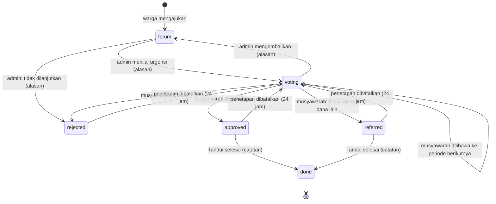

# Keputusan musyawarah (`/keputusan`, `/keputusan/[tahun]`, `/admin/keputusan`)

Menutup siklus SUARA. Sebelum fitur ini, usulan berhenti di `voting`: rekomendasi dihitung, tetapi tidak ada tempat
mencatat **apa yang akhirnya diputuskan musyawarah desa** dan **mengapa**. Sekarang admin mencatat hasil rapat untuk
semua usulan dalam hitungan, warga membacanya berdampingan dengan rekomendasi, dan periode berikutnya mewarisi
akibatnya.

Prinsip yang dijaga: **SUARA merekomendasikan, musyawarah memutuskan, dan setiap perbedaan punya alasan yang bisa
dibaca.** Halaman dan hasil cetaknya menyebut diri **ringkasan keputusan musyawarah, bukan pengesahan anggaran**.

## Daftar isi

- [Cara mencoba](#cara-mencoba)
- [Siklus status](#siklus-status)
- [Yang dicatat tiap penetapan](#yang-dicatat-tiap-penetapan)
- [Sidik: dua admin, satu hitungan](#sidik-dua-admin-satu-hitungan)
- [Akibat pada periode berikutnya](#akibat-pada-periode-berikutnya)
- [Pembatalan](#pembatalan)
- [Jejak publik](#jejak-publik)
- [Layar](#layar)
- [Draf di perangkat](#draf-di-perangkat)
- [Cetak dan CSV](#cetak-dan-csv)
- [Pengujian](#pengujian)
- [Keterbatasan](#keterbatasan)

## Cara mencoba

Setelah migrasi 0006 dan `seed_keputusan.sql` dijalankan (lihat [README](../README.md#menyiapkan-database)):

1. Buka `/keputusan` tanpa masuk: **Tahun Anggaran 2026** sudah diputuskan (data purwarupa, diputuskan sebelum SUARA
   dipakai), dan **Tahun Anggaran 2027** belum.
2. Masuk sebagai `admin` / `admin123`, buka **Admin → Keputusan**. Tekan **Isi sisanya sesuai rekomendasi**, lalu ubah
   satu usulan, misalnya Drainase menjadi **Ditolak**: kolom alasan muncul dan wajib diisi.
3. Isi tanggal dan catatan musyawarah, centang "Ini hasil musyawarah yang sebenarnya", lalu **Tetapkan keputusan**.
4. Buka `/keputusan/2027`: dua Garis Pagu, bagian "Di mana musyawarah berbeda", tabel, anggaran tiap RW, dan tombol
   cetak serta unduh CSV. Halaman utama, forum, dan detail usulan ikut berubah seketika.
5. **Batalkan dalam 24 jam** supaya Garis Pagu penuh kembali di halaman utama.

## Siklus status

| Hasil di layar | Kode | Status sesudahnya | Memakai pagu | Alasan |
|---|---|---|---|---|
| Disetujui | `disetujui` | `approved` | Ya | Wajib bila berbeda dari rekomendasi |
| Diajukan ke dana lain | `dana_lain` | `referred` | Tidak | Wajib, ditambah nama sumber dana (3–80 karakter) |
| Dibawa ke periode berikutnya | `dilanjutkan` | tetap `voting` | Tidak | Wajib bila berbeda dari rekomendasi |
| Ditolak | `ditolak` | `rejected` | Tidak | Selalu wajib |

Alasan 20–500 karakter. **"Berbeda dari rekomendasi"** berarti disetujui padahal tidak terpilih, atau tidak disetujui
padahal terpilih. Untuk keputusan yang sejalan dan tanpa alasan tertulis, **sistem menulis kalimat dari potret
angkanya**, misalnya *"Mengikuti rekomendasi: peringkat 2 dari 7, skor 9,6."* (ditulis oleh SQL dan dibuktikan sama
dengan versi TypeScript di tes).

`referred` ikut tertutup dari dukungan tanpa perubahan pada aturan dukungan: `dukung_usulan` sudah menolak status selain
`forum` dan `voting`.

## Yang dicatat tiap penetapan

Penetapan **utuh**: semua usulan `voting` yang ikut dihitung mendapat tepat satu hasil, dalam satu transaksi
(`tetapkan_keputusan`). Tidak ada penetapan sebagian. Usulan `voting` yang disembunyikan tidak ikut dihitung dan
statusnya tetap.

Disimpan sebagai **potret** (tabel `periode` dan `keputusan`): pagu, bobot, dan per usulan peringkat, skor, status
rekomendasi, biaya, dukungan, urgensi, RW, judul saat itu, serta `beda_dari_rekomendasi`. **Halaman publik membaca potret,
bukan menghitung ulang**, jadi dukungan, bobot, atau pagu yang berubah sesudahnya tidak mengubah keputusan yang sudah
tercatat. Judul di potret tetap, tetapi view publik (`v_keputusan`) mengosongkannya bila usulannya kelak disembunyikan.

Batas yang ditegakkan **di database**: total `disetujui` tidak melebihi pagu; tanggal musyawarah tidak di masa depan
(menurut WIB); catatan musyawarah 20–1.000 karakter; butir tidak kurang, ganda, asing, atau salah bentuk (JSON yang
salah bentuk menghasilkan `tidak_valid`, bukan pengecualian).

## Sidik: dua admin, satu hitungan

Penetapan membawa dua penjaga:

- **Versi periode** (`periode.versi`, hanya naik): penetapan kedua dengan versi yang sama ditolak (`sudah_ditetapkan`,
  menyebut nama dan jam penetapan pertama). Versi tidak dipakai ulang, jadi halaman lama yang dibuka sebelum sebuah
  penetapan dibatalkan lalu dibuka lagi pun ditolak (`bentrok`).
- **Sidik hitungan** (`sidik_hitungan()`): ringkasan id + status rekomendasi tiap usulan, pagu, dan versi bobot. Bila
  sudah berubah sejak halaman dibuka (pagu diubah, bobot diubah, usulan masuk atau keluar, status rekomendasi bergeser),
  penetapan ditolak dengan jawaban yang memuat keadaan sekarang; aplikasi membandingkannya dengan yang dibaca admin dan
  menyebut apa yang berubah ("Pagu berubah dari Rp 300 juta menjadi Rp 310 juta." "Talud sekarang terpilih (tadinya
  ditunda)."). **Jumlah dukungan sengaja tidak masuk sidik**: dukungan boleh bergerak selama rapat asalkan rekomendasinya
  sama.

Halaman admin dan fungsi penetapan membaca keadaan dari fungsi yang sama (`sidik_hitungan()`), jadi sidiknya tidak bisa
berbeda sumber. Penetapan dan pembatalan memakai kunci `hitungan_anggaran` yang sama dengan `pindahkan_status` dan
`tampilkan_kembali`, lalu mengunci baris periode.

## Akibat pada periode berikutnya

Saat ditetapkan, `wilayah.anggaran_lalu` tiap RW **diganti** dengan jumlah biaya `disetujui` pada periode itu (RW tanpa
bagian menjadi 0; `dana_lain` tidak dihitung), dan **periode tahun berikutnya dibuka**. Komponen pemerataan pada hitungan
berikutnya membaca `anggaran_lalu` itu: RW yang baru menerima banyak mendapat skor pemerataan lebih rendah.

Contoh (data demo, pagu Rp 300 juta, mengikuti rekomendasi sepenuhnya, terpakai Rp 285 juta):

| RW | `anggaran_lalu` sebelum | sesudah |
|---|---|---|
| RW 01 | Rp 250 juta | Rp 0 |
| RW 03 | Rp 60 juta | Rp 85 juta |
| RW 07 | Rp 0 | Rp 200 juta |

Admin melihat tabel ini ("sekarang → sesudah") **sebelum** menetapkan. Potret `anggaran_lalu` sebelum penetapan disimpan di
`periode.wilayah_sebelum`, dipakai pembatalan dan kolom "Periode lalu" di halaman publik.

Dua teks beranda yang tadinya disimpulkan dari `anggaran_lalu = 0` diperbaiki, karena nilai itu hanya berarti **periode
lalu**: "Belum pernah menerima anggaran" menjadi "Tidak menerima anggaran" di bawah judul "Anggaran periode lalu", dan
ringkasan Garis Pagu berkata "tidak menerima anggaran periode lalu". Tanpa usulan dalam hitungan, beranda tidak lagi
menggambar batang kosong atau `NaN%`: ia menjelaskan keadaannya dan menautkan keputusan periode terakhir.

## Pembatalan

Penetapan **terakhir** bisa dibatalkan **dalam 24 jam**, dengan alasan (10–500 karakter), selama belum ada usulannya yang
`done`. Yang dikembalikan: status usulan, `anggaran_lalu`, dan periode (tahun berikutnya ditutup lagi). Catatan lama
**tidak dihapus**: keputusan diberi `dibatalkan_pada` (tidak tampil di view publik), dan pembatalan tercatat di jejak
publik beserta alasan dan catatan rapat yang dibatalkan.

Ditolak dengan penjelasan bila: lewat 24 jam, bukan penetapan terakhir, sudah ada yang selesai, atau hitungan akan melebihi
**16 usulan** (usulan yang dikembalikan ditambah yang sudah menunggu di periode baru; pesannya menyebut berapa yang harus
dikembalikan ke pembahasan lebih dulu).

Setelah 24 jam keputusan tetap. Jalan keluar untuk **data demo** (bukan data sebenarnya): jalankan
[supabase/demo_pulihkan_periode.sql](../supabase/demo_pulihkan_periode.sql) di SQL Editor. Ia memanggil fungsi inti
yang sama dengan tombol batal (`pulihkan_periode`), hanya tanpa pemeriksaan 24 jam, dan tetap menolak bila ada yang selesai.

## Jejak publik

Tiap penetapan menulis satu catatan `decision` ringkasan (tahun, jumlah tiap hasil, terpakai, sisa, jumlah yang berbeda),
dicatat **terakhir** supaya tampil paling atas, dan satu catatan `decision` per usulan (tampil di riwayat usulan di forum).
Penandaan selesai menulis `status_change`. Pencatat adalah nama pengguna admin, seperti pagu dan bobot. Semuanya muncul di
`/keputusan` (jejak lengkap dengan penyaring jenis dan "Muat lebih banyak", keadaannya di alamat) dan di beranda.

## Layar

| Layar | Isi |
|---|---|
| `/keputusan` | Periode berjalan (ringkasan rekomendasi saat ini), periode yang sudah diputuskan, jejak lengkap |
| `/keputusan/[tahun]` | Cap DIPUTUSKAN, **dua Garis Pagu** (Rekomendasi SUARA dan Keputusan musyawarah, skala sama; yang berbeda ditandai bingkai putus-putus dan ≠), **Di mana musyawarah berbeda** (alasan dengan huruf besar; bila tidak ada: "Musyawarah mengikuti seluruh rekomendasi."), semua keputusan, anggaran tiap RW, catatan musyawarah, cetak, CSV. `404` untuk tahun yang tidak ada |
| `/keputusan/[tahun]/csv` | Unduhan, **baca saja** |
| `/admin/keputusan` | **Lembar kerja** (satu baris per usulan; empat pilihan hasil sebagai kelompok tombol; tanpa pilihan bawaan), ringkasan yang menempel di dasar layar, **Tinjau dan tetapkan** (pratinjau, akibat untuk RW, tanggal, catatan, kotak centang), **Sesudah penetapan** (sisa waktu dan batal), **Pekerjaan berjalan** (Tandai selesai) |
| Detail usulan di forum | Blok tenang "Diputuskan pada musyawarah 20 November 2026: Disetujui", alasan, dan catatan penyelesaian |
| `/admin` | Baris "Tahun Anggaran 2027: n usulan menunggu keputusan" |

Keadaan yang dirancang: nol usulan (lembar diganti penjelasan), melebihi pagu (tombol ditahan dengan angka kelebihan dan
ditolak juga oleh database), hitungan berubah saat mengisi (menyebut yang berubah, draf utuh), admin lain sudah menetapkan
(nama, jam, tautan hasil), sesi habis (`belum_masuk`, tautan masuk lagi, draf utuh), lewat 24 jam (tombol batal hilang
dengan keterangan), pembatalan terhalang batas 16 (penjelasan dan jalan keluar), data cadangan (penanda "Ini data contoh").

Penghitung sisa waktu diperbarui tiap menit dan **bukan wilayah live**; ringkasan lembar kerja diumumkan pembaca layar
satu kali setelah 1,2 detik tenang, bukan tiap klik.

## Draf di perangkat

Rapat bisa lama dan sinyal bisa putus, jadi pilihan, tanggal, dan catatan disimpan di `localStorage` (dibungkus
`try/catch`; tanpa penyimpanan, lembar tetap berfungsi), 400 ms setelah gerakan terakhir. Kuncinya per **tahun dan sidik**.
Bila hitungan berubah (sidik baru), draf terbaru tahun yang sama tetap dipulihkan untuk usulan yang masih ada, dengan
pemberitahuan. Ada tombol "Hapus draf"; draf dibuang setelah penetapan berhasil. **Draf tidak pernah sampai ke server**
sebelum admin menekan Tetapkan.

## Cetak dan CSV

`@media print` menghasilkan lembar A4 untuk papan pengumuman balai desa: tanpa navigasi dan tombol, latar putih, batang
bergaris hitam (yang berbeda putus-putus, sisa diarsir) sehingga terbaca hitam-putih, tabel tidak terpotong di tengah baris,
dan catatan kaki "Ringkasan keputusan musyawarah, bukan pengesahan anggaran. Data purwarupa." beserta alamat halaman.

CSV: UTF-8 dengan BOM, CRLF, dari potret publik. Sel **teks** yang diawali `= + - @` (juga tab dan carriage return) diberi
awalan `'` supaya tidak berjalan sebagai rumus; sel angka tidak diubah. Pemisahnya koma: pada Excel dengan pengaturan
regional Indonesia, bila kolom menyatu, buka lewat *Data → From Text/CSV* dan pilih pemisah koma. Data cadangan tidak
diunduh (respons 503), supaya berkas contoh tidak dikira asli.

## Pengujian

| Lapisan | Perintah | Yang dibuktikan |
|---|---|---|
| SQL (PGlite) | `npm test` (`supabase/tests/keputusan.test.ts`) | baseline beranda tidak berubah (K-01); hanya admin aktif, `anon` tanpa `execute`, view kosong bagi `anon` (K-02); tiap aturan penetapan (K-03); contoh Rp 285 juta dan `anggaran_lalu` 0 / 85 / 200 juta (K-04); potret tetap (K-05); status rekomendasi SQL = `statusUsulan` TypeScript di sembilan kombinasi pagu dan bobot (K-06); pembatalan memulihkan persis, 24 jam, `done`, batas 16, bukan terakhir (K-07); dua penetapan (K-08); skrip pemulihan demo |
| Unit | `npm test` | aturan alasan, ringkasan lembar, akibat RW, penjelasan bentrok, sisa waktu, CSV dan injeksi rumus (K-15), draf, jejak, kalimat, pesan, dua batang, `persen`, kalimat beranda (K-10) |
| E2E | `npm run e2e` (`admin-keputusan.spec.ts`) | alur penuh dan konsol bersih (K-12), cache langsung segar (K-11), draf dan sesi habis (K-13), PDF A4 (K-14), CSV (K-15), axe, keyboard, reflow, target 44 px (K-16), nol usulan (K-10) |

## Keterbatasan

- **Koreksi setelah 24 jam** di luar cakupan: keputusan tetap. Hanya data demo yang bisa dipulihkan, lewat SQL.
- **Satu periode berjalan.** Usulan yang masuk hitungan setelah penetapan otomatis menjadi bagian periode berikutnya; tidak
  ada penjadwalan beberapa periode sekaligus.
- **Tanda tangan digital, unggah berkas, rencana kerja rinci dan progres persen, notifikasi** tidak ada. Catatan
  penyelesaian hanya teks dan satu angka biaya.
- **Data TA 2026 adalah data purwarupa** (pagu Rp 320 juta dan isinya dibuat untuk demo); tidak punya potret rekomendasi.
- **Cetak diuji lewat `page.pdf` Chromium**, bukan semua mesin cetak dan printer. Gaya cetak mengandalkan lebar isi A4.
- **Server tiruan E2E bukan PostgREST asli.** Contohnya, kolom `date` harus dikembalikan sebagai `YYYY-MM-DD` seperti PostgREST;
  tiruan diperbaiki untuk itu (`tanggalSebagaiTeks`), dan pembaca tanggal di aplikasi tahan terhadap bagian waktu.
- **Pembatalan dan data periode berikutnya:** karena `keputusan.tahun` tidak memakai kunci asing ke `periode` (supaya catatan
  batal bertahan saat periode berikutnya dihapus), integritas itu dijaga oleh fungsi, bukan oleh database.
- Aturan dukungan (satu per usulan, boleh banyak usulan) **tidak diubah** dan masih sementara.
