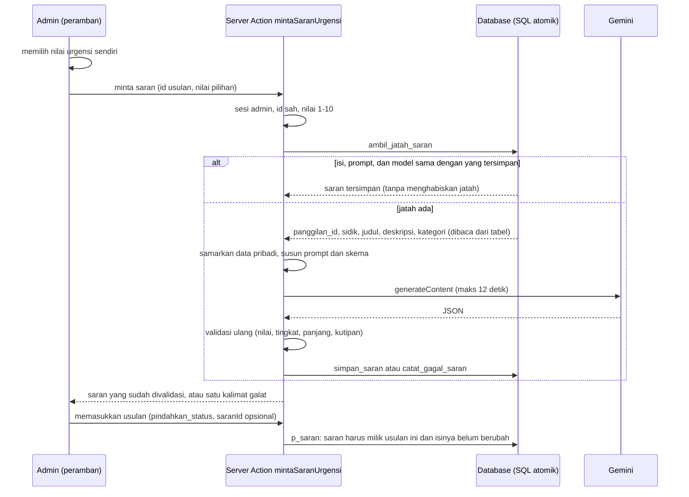

# Saran urgensi dari AI

Fitur opsional: sebelum memasukkan usulan warga ke hitungan anggaran, admin bisa meminta **saran** nilai urgensi (1 sampai 10)
dari AI (Google Gemini), lengkap dengan alasan yang mengutip kalimat usulan. **Admin yang menetapkan.** Saran tidak pernah mengisi
pilihan, tidak pernah memindahkan status, dan tidak pernah menolak usulan. Rumus skor tidak berubah: yang masuk ke skor tetap nilai
yang dipilih admin ([README](../README.md#cara-suara-menilai-usulan)).

Brief dan kriteria penerimaan: [prompts/saran-urgensi.md](prompts/saran-urgensi.md).

## Yang membuatnya bukan sekadar "tombol AI"

1. **Admin menilai dulu, baru melihat saran.** Tombolnya baru aktif setelah admin memilih nilai (`aria-disabled` dengan keterangan), dan
   Server Action menolak permintaan tanpa nilai 1 sampai 10. Ini mencegah penilaian terjangkar pada angka AI.
2. **Setiap alasan menunjuk kalimat di usulan**, dan server memeriksa kutipannya benar-benar ada (alasan dengan kutipan palsu dibuang;
   bila tidak ada yang tersisa, saran dianggap gagal). Di layar, kutipan bisa disorot di isi usulan.
3. **Terbuka ke warga.** Bila admin membuka saran sebelum memasukkan usulan, halaman usulan menulis "Urgensi 8 dari 10, ditetapkan
   admin. Saran AI sebelumnya: 7." dengan alasannya, dan jejak keputusan memuat nilai saran. Bila tidak dibuka, tidak ada jejak AI.
4. **Tetap berguna tanpa AI.** Kuota habis, jaringan putus, atau kunci belum dipasang tidak pernah menghalangi admin. Tanpa
   `GEMINI_API_KEY` tidak ada satu pun jejak fitur di antarmuka.

## Alur

## Keputusan teknis dan alasannya

| Topik | Keputusan | Alasan |
|---|---|---|
| Antarmuka Gemini | `generateContent` lewat `fetch`, tanpa dependensi | Didukung penuh, bentuk keluaran terstruktur (`responseMimeType` + `responseSchema`) saya kenal pasti. Interactions disarankan Google, tetapi bentuk keluaran terstruktur dan cara menonaktifkan penyimpanan permintaannya tidak bisa saya pastikan dari dokumen yang dibaca; `generateContent` tidak membuat sumber daya yang bisa dilanjutkan. |
| Model | `GEMINI_MODEL`, bawaan `gemini-3.5-flash-lite` | Nama model tidak konsisten antar halaman dokumen Google yang dibaca (22 November 2026), jadi tidak ditanam di kode. **Bawaan ini belum dikalibrasi**: dipilih karena varian *lite* paling mungkin tersedia di paket gratis. |
| Kunci | Header `x-goog-api-key`, hanya di server | Tidak pernah di URL, log, respons, atau bundel klien. `GEMINI_BASE_URL` hanya diterima untuk alamat resmi atau `http://127.0.0.1`/`localhost` (server tiruan), supaya kunci tidak terkirim ke tujuan lain karena salah ketik. |
| Batas waktu | 12 detik keseluruhan (`AbortSignal`) | Satu kali ulang **hanya** untuk galat jaringan atau 503, tidak untuk 429. Batas permintaan Cloud Run bawaan (300 detik) jauh lebih panjang. |
| Data yang dikirim | Judul, deskripsi, kategori, **sudah disamarkan**, ditambah rubrik | Tidak dikirim: nama, RW, dukungan, biaya, komentar, id. Dukungan dan RW sudah dinilai komponen lain; mengirimnya membuat urgensi menghitung hal yang sama dua kali. |
| Pengisian | Tidak pernah | Hanya admin yang memilih. Alasan AI hanya bisa disalin sebagai **draf** (ditandai "Draf dari AI") ke kolom alasan yang tetap divalidasi 20 sampai 500 karakter. |
| Cache | Saran disimpan per (usulan, sidik isi, versi prompt, model) | Isi dan prompt yang sama memakai saran tersimpan: tidak memanggil AI, tidak menghabiskan jatah. Mengubah prompt: naikkan `VERSI_PROMPT`. |

## Data (`supabase/migrations/0007_saran_urgensi.sql`)

- **`saran_urgensi`**: nilai, keyakinan, `alasan` (jsonb: teks + kutipan), `pertanyaan`, model, versi prompt, `sidik_isi` (md5 judul +
  deskripsi + kategori), pembuat. Unik per (usulan, sidik, versi, model). RLS aktif tanpa policy.
- **`panggilan_ai`**: tiap permintaan (akun, usulan, waktu, hasil `diminta`/`berhasil`/`gagal`, kode, apakah dihitung, durasi). **Tanpa isi usulan
  dan tanpa isi jawaban.**
- **`proposals.saran_dibuka_id`**: saran yang dibuka admin saat memasukkan usulan; hanya ini yang tampil publik, bukan saran terakhir yang tersimpan.
  Dikosongkan saat usulan dikembalikan ke forum.
- **Fungsi** (`revoke execute` dari `public, anon, authenticated`; semuanya memeriksa sendiri admin aktif): `ambil_jatah_saran`, `simpan_saran`,
  `catat_gagal_saran`, `sidik_isi_usulan`, dan `pindahkan_status` yang diperluas dengan `p_saran uuid default null` (versi 8 argumen dihapus
  di migrasi yang sama supaya PostgREST tidak melihat dua overload). Tanpa `p_saran` perilakunya sama seperti sebelumnya.
- **`v_usulan`** mendapat `saran_nilai`, `saran_keyakinan`, `saran_alasan`, `saran_model` di ujung, dikosongkan untuk usulan yang disembunyikan.
- **Batas**: 10 permintaan per jam per admin dan 100 per 24 jam untuk seluruh desa, dijaga di database dengan satu kunci advisory. Hanya
  permintaan yang sampai ke AI (berhasil, atau jawabannya tak bisa dipakai) yang dihitung; kuota habis, jaringan, atau batas waktu **tidak**
  menghabiskan jatah. Dua permintaan untuk usulan yang sama dalam 30 detik: yang kedua ditolak ("sedang dibuat"), jadi klik ganda dan dua admin
  hanya memanggil AI sekali.

## Keamanan dan ketahanan

Isi usulan ditulis warga, jadi **tidak tepercaya**.

- **Injeksi prompt.** Instruksi (sistem) dipisah dari data, data dibungkus pembatas `<<<USULAN_WARGA … USULAN_WARGA>>>`, pembatas di dalam isi
  dinetralkan (`<<<` dan `>>>` diganti `< < <` dan `> > >`), dan prompt menyatakan isi adalah data, bukan perintah. **Keamanan tidak bergantung
  pada itu saja**: keluaran dibatasi skema, divalidasi ulang di server (nilai bilangan bulat 1–10, tingkat dihitung dari nilai bukan dari jawaban AI,
  panjang dibatasi, kutipan harus ada di teks yang dikirim, kunci tambahan dibuang), disimpan lewat fungsi SQL yang memeriksa lagi, dan manusia
  yang memutuskan. Model yang menuruti injeksi paling jauh menghasilkan saran bernilai tinggi yang tetap hanya saran.
- **Samaran data pribadi** (`lib/samarkan.ts`): email, NIK/KK 16 digit, nomor telepon Indonesia, nomor rekening (bila disebut sebagai rekening),
  alamat bernomor ("Jl. Mawar No. 12"), dan sapaan + nama ("Bu Sari", "Pak RT Budi", "bernama Sutrisno") diganti `[email]`, `[telepon]`, `[nama]`, dan
  seterusnya. **Berbasis pola, tidak sempurna**: nama tanpa sapaan ("Sutrisno melapor") dan alamat tanpa nomor lolos. Karena itu admin melihat teks yang akan
  dikirim lebih dulu (`
` "Teks yang dikirim ke AI", bagian samaran ditandai). Biaya, "RW 07", "SDN 03", dan angka lain tanpa konteks pribadi tidak disamarkan.
- **Teks AI sebagai teks biasa** (tidak ada `dangerouslySetInnerHTML`).
- **Catatan server** hanya jenis galat, kode HTTP, model, dan durasi (`gemini gagal: kuota 429 model=… 812ms`): tidak ada isi usulan dan tidak ada kunci.
- **Data paket gratis Gemini** boleh dipakai Google untuk mengembangkan produk, dan peninjau manusia bisa membacanya ("Do not submit sensitive, confidential,
  or personal information to the Unpaid Services"). Itu alasan data yang dikirim dibatasi dan disamarkan. Untuk data warga yang sebenarnya, pertimbangkan paket berbayar.

## Layar

- **Admin** (`/admin/usulan/[id]`, hanya usulan warga berstatus forum): **catatan pinggir** di samping pilihan urgensi (di bawahnya pada ponsel). Keadaannya: tombol
  terkunci sebelum memilih; "Membaca usulan…" (setelah 6 detik: "Masih menunggu. Anda bisa melanjutkan tanpa saran."); saran; galat dengan satu kalimat jujur
  (kuota, batas laju dengan kapan bisa lagi, batas waktu, jaringan, filter keamanan, jawaban tak bisa dipakai) dan "Coba lagi" bila masuk akal. Selisih dengan
  pilihan admin dijelaskan netral (sama, berdekatan, berjauhan) dan diperbarui saat admin mengganti pilihan. Saran dan keterangan draf hidup di luar `<fieldset key>`,
  jadi tidak hilang saat formulir dipasang ulang setelah galat server.
- **Publik** (`/forum/[id]`): satu kalimat di blok Urgensi dengan `
` alasan dan kutipan.
- **Beranda** (`CaraKerja`): tiga kalimat "Peran AI" menyesuaikan keadaan. Dengan kunci: "AI menyarankan nilai urgensi beserta alasan yang mengutip usulan.
  Admin desa yang menetapkan." Tanpa kunci: "AI tidak dipakai untuk menilai urgensi. Admin desa menilainya … dengan rubrik." Beranda ikut diprerender: **setelah
  memasang atau mencabut kunci, build dan deploy ulang** supaya teksnya ikut berubah (halaman admin membaca kunci saat permintaan, jadi langsung aktif).

## Mutu saran: belum dikalibrasi

`npm run urgensi:kalibrasi` (dijalankan pemilik karena butuh kunci; tanpa `--jalankan` hanya menampilkan rencana 114 panggilan) mengukur tujuh usulan seed bernilai manusia
(Gapura 3, Balai warga 2, Jalan SDN 03 8, Talud 10, Drainase 9, Jembatan 8, Lampu PJU 7) ditambah 12 kasus buatan (kabur, hiperbola, bahaya dengan bahasa tenang, data pribadi,
campuran Jawa/Indonesia/gaul, tiga percobaan injeksi), 3 ulangan per kasus, untuk `gemini-3.8-flash` (berpikir `low`) dan `gemini-3.5-flash-lite`. Dilaporkan: selisih mutlak
rata-rata, berapa yang selisihnya ≤ 1 dan ≤ 2, korelasi urutan, kestabilan, kutipan palsu, waktu rata-rata dan p95, serta berapa injeksi yang menaikkan nilai.

**Belum pernah dijalankan** (kunci tidak ada pada agen yang membangun fitur ini), jadi **tidak ada angka mutu di dokumen ini** dan model bawaan belum dipilih berdasarkan data. Tujuh
contoh bukan bukti akurasi; jangan menyetel prompt sampai pas dengan tujuh data itu (paling banyak dua putaran, dan catat keduanya).

## Pengujian

- **Unit:** `lib/samarkan.test.ts` (24 kasus yang harus tersamarkan, 14 yang tidak boleh, bentuk hasil), `lib/saran-urgensi.test.ts` (validator, kutipan, prompt, injeksi, perbandingan),
  `lib/gemini.test.ts` (konfigurasi, badan permintaan, 429/400/403/5xx/kosong/diblokir/terpotong, ulang 503 dan jaringan, batas waktu, tidak ada kunci atau isi usulan di log).
- **SQL (PGlite):** `supabase/tests/saran-urgensi.test.ts`: baseline `rekomendasi_resmi` tidak berubah, hak `execute`, RLS tanpa policy, jatah per jam dan per hari, klik ganda, gangguan tidak
  menghabiskan jatah, cache, `pindahkan_status` dengan dan tanpa saran (saran milik usulan lain atau basi ditolak, nilai di jejak dibaca dari tabel), `v_usulan`.
- **E2E:** `e2e/saran-urgensi.spec.ts` (server aplikasi port 3102 berkunci Gemini **tiruan**, `e2e/gemini-palsu.ts`) dan `e2e/admin-saran-tanpa-kunci.spec.ts` (server port 3100 tanpa kunci).
  **Gemini sungguhan tidak pernah dipanggil dari tes otomatis.** Yang tidak ikut terverifikasi: perilaku, kuota, dan filter keamanan Gemini yang asli, serta mutu nilainya.
  **Hasil terakhir (mesin pengembang):** 149 dari 150 tes E2E lulus. Satu yang gagal, `simulasi-kinerja` (tugas utas utama 105 ms, batas 100 ms), adalah tes kinerja lama yang peka terhadap kecepatan mesin dan tidak menyentuh fitur ini; dijalankan ulang, proyek admin dan saran seluruhnya lulus (69 tes). Unit dan SQL: 811 tes lulus.

## Memasang

1. Buat kunci di <https://aistudio.google.com/apikey> (pembuat minimal 18 tahun; jangan menautkan akun penagihan bila ingin tetap di paket gratis).
2. `.env.local`: `GEMINI_API_KEY=...` (jangan di percakapan, kode, atau commit). Opsional `GEMINI_MODEL` dan `GEMINI_THINKING`.
3. Jalankan `supabase/migrations/0007_saran_urgensi.sql` **sebelum** memasang kode (kode membaca kolom `saran_*` di `v_usulan`; tanpanya halaman usulan publik jatuh ke data cadangan
   dan `/api/health` menjawab `"db":"error"`). Cek: `/api/health` memuat `"saran_ai":true` bila kunci terpasang.
4. Cloud Run: simpan kunci di Secret Manager, sambungkan sebagai variabel lingkungan, lalu **build dan deploy ulang**. Kunci dari proyek Google Cloud yang punya penagihan aktif bisa terhitung berbayar.

## Keterbatasan

- Mutu belum diukur (di atas). Model bawaan adalah tebakan yang masuk akal, bukan hasil kalibrasi.
- Samaran data pribadi tidak sempurna; nama tanpa sapaan lolos.
- Hanya usulan warga berstatus `forum`. Tidak ada penilaian massal, obrolan, ringkasan komentar, atau penyedia kedua.
- Sorotan kutipan hanya di isi usulan; kutipan dari judul atau bagian yang disamarkan tidak disorot (dinyatakan di layar).
- Batas 10 per jam dan 100 per hari adalah batas aplikasi, bukan batas kuota Gemini (yang hanya terlihat di AI Studio dan bisa habis kapan saja).
