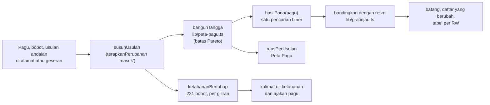

# Simulasi anggaran (`/simulasi`)

Warga mengubah pagu dan bobot, lalu **langsung melihat** usulan mana yang terbiayai, siapa yang kebagian, dan berapa
pagu yang dibutuhkan supaya sebuah usulan terbiayai. **Tidak ada yang disimpan** dan rekomendasi resmi tidak berubah.
Semua orang boleh memakainya, tanpa masuk.

Tiga pertanyaan yang dijawab halaman ini tanpa penjelasan tambahan:

1. *"Kalau pagunya segini, usulan mana yang jadi?"* → batang hasil dan daftar yang berubah dari rekomendasi resmi.
2. *"Berapa pagu yang dibutuhkan supaya usulan RW saya terbiayai?"* → **Peta Pagu**.
3. *"Jangan-jangan bobotnya dipilih supaya hasilnya begini?"* → **uji ketahanan**: hasilnya dihitung ulang untuk semua 231
   kombinasi bobot kelipatan 5, dan halaman menyebut berapa kombinasi yang menghasilkan pilihan yang sama.

## Cara mencoba

Setelah aplikasi berjalan (tanpa SQL baru dan tanpa variabel lingkungan baru):

1. Buka `/simulasi`. Geser pagu ke **Rp 505 juta**: **Talud** menjadi *Terbiayai*.
2. Kembalikan ke **Rp 300 juta**: kalimat uji ketahanan menyebut **231 dari 231** kombinasi bobot (selama data demo belum
   diubah). Di bawahnya ada ajakan **Coba pagu Rp 280 juta**, yaitu pagu terdekat yang hasilnya bergantung pada bobot.
3. Tekan **Dukungan saja** (bobot 100/0/0): yang terbiayai tetap sama, tetapi Gapura dan Balai warga berubah dari
   *Tidak terpilih* menjadi *Ditunda*, dan halaman menyebutnya.
4. Di **Tambah usulan dari forum**, pilih satu usulan dan urgensi yang Anda andaikan: posisinya langsung terlihat.
5. **Bagikan simulasi ini** menyalin tautan; buka di perangkat lain dan keadaannya sama.

## Keadaan ada di alamat

```
/simulasi?pagu=350000000&bobot=20-60-20&tambah=<uuid>.8&tambah=<uuid>.5
```

| Parameter | Isi | Catatan |
|---|---|---|
| `pagu` | rupiah bulat, Rp 10 juta sampai Rp 10 miliar | Pagu yang diketik boleh bukan kelipatan Rp 5 juta |
| `bobot` | `popularitas-urgensi-pemerataan`, tiga bilangan bulat berjumlah 100 | Dari geseran selalu kelipatan 5; alamat boleh memuat yang lain (mis. bobot resmi 33/33/34) |
| `tambah` | `id.urgensi` (1 sampai 10), satu per parameter atau dipisah koma | Hanya usulan berstatus `forum` dan tidak tersembunyi; paling banyak `16 − jumlah usulan voting` |

- **Nilai yang sama dengan resmi tidak ditulis.** Keadaan resmi adalah alamat polos `/simulasi`.
- **Masukan rusak tidak menggagalkan halaman.** Nilai tidak sah diabaikan diam-diam (kembali ke nilai resmi). Usulan di
  `tambah` yang sudah bukan berstatus forum, disembunyikan, atau tidak dikenal diabaikan dengan **satu kalimat
  pemberitahuan**; yang melebihi batas 16 usulan juga.
- Alamat ditulis dengan `history.replaceState` **300 ms** setelah gerakan terakhir (bukan tiap langkah geseran), dan
  tombol kembali/maju memulihkan keadaannya. Tidak ada rahasia atau data pribadi di alamat: hanya angka dan id usulan.
- Dari halaman detail usulan berstatus forum ada tautan tenang **"Lihat kalau usulan ini dihitung"** ke
  `/simulasi?tambah=<id>.5`.

## Cara kerja



Seluruhnya dihitung **di peramban** (tidak ada Server Action per geseran: sinyal warga lemah) dengan fungsi murni di
`lib/`. **Tidak ada rumus baru**: urutan dan skor usulan diambil dari `urutanOptimal`, fungsi yang sama dengan yang
dipakai `pilihOptimal`.

Data dibaca server di `lib/simulasi-data.ts` (`'use cache'`, tag `beranda`, `pengaturan`, `forum`, `cacheLife` sama dengan
beranda): usulan voting dengan `created_at` (supaya urutan seri sama dengan SQL), usulan forum yang bisa ditambahkan
(150 terbaru), wilayah, pagu, dan bobot resmi. Tiap bagian jatuh ke data cadangan (`lib/simulasi-cadangan.ts`) bila
database tidak menjawab dalam 3 detik, dengan penanda **"Ini data contoh."**

Seperti beranda, halaman **tidak dibungkus `<Suspense>`**: dengan `cacheLife` itu datanya tidak ikut App Shell, dan di dalam
`<Suspense>` isinya dialirkan sesudah shell lalu ditampilkan oleh skrip, sehingga tanpa JavaScript halamannya tersembunyi.
Tanpa `<Suspense>`, HTML pertama sudah memuat rekomendasi resmi, Peta Pagu, tabel per RW, dan kalimat uji ketahanan
(dihitung di server untuk keadaan resmi). `export const instant = false` mencatat bahwa ini disengaja.

### Bobot yang menyeimbangkan diri

Tiga geseran 0–100, langkah 5, **selalu berjumlah 100**: menggeser satu membagi ulang dua lainnya secara proporsional
dengan metode sisa terbesar; bila keduanya nol, dibagi rata (`lib/bobot-simulasi.ts`). Ini sengaja berbeda dari halaman
admin, yang membiarkan tiga kolom diketik bebas dan menolak simpan bila jumlahnya bukan 100: di simulasi setiap keadaan
harus sah. Penjelasan tiap bobot memakai kalimat yang sama dengan halaman admin (`PENJELASAN_BOBOT`).

Pilihan cepat: **Resmi**, **Dukungan saja** (100/0/0), **Keselamatan dulu** (10/80/10), **Merata dulu** (10/30/60). Preset
hanya jalan pintas yang mengisi geseran.

## Peta Pagu

Elemen khas halaman ini. Satu baris per usulan; sumbu mendatar adalah pagu; **ruas hijau** adalah rentang pagu tempat
usulan itu terbiayai; **garis tebal** adalah pagu Anda dan **garis putus-putus tipis** pagu resmi. Baris diurutkan dari
usulan yang paling cepat terbiayai. Data demo, langkah Rp 5 juta. Kolom kanan adalah hasil hitungan nyata (diuji di
`lib/peta-pagu.test.ts`); letak ruas pada gambar teks hanya perkiraan:

```
                 0       200       400       600      800 juta
Lampu PJU        ··██··███·████│██████████████████████   Rp 40–65, 110–155, lalu dari 195
Jembatan         ···█·█··██████│██████████████████████   Rp 70–85, 110–125, lalu dari 160
Drainase         ····█·███·████│██████████████████████   Rp 90–105, 130–190, lalu dari 200
Jalan SDN 03     ·········█··██│██████████████████████   Rp 195, lalu dari 285
Balai warga      ··············│···███·······███·····█   Rp 395–460, 615–680, lalu dari 795
Gapura           ··············│······██·········█████   Rp 465–500, lalu dari 685
Talud            ··············│········██████████████   dari Rp 505
                               ▲ pagu Anda (garis tebal)
```

Tiap baris punya **kalimat** di sebelahnya, mis. *"Talud baru muat kalau pagunya Rp 505 juta, Rp 205 juta lebih banyak dari
pagu sekarang."* dan *"Gapura muat pada Rp 465–500 juta, lalu lagi dari Rp 685 juta."*

### Kenapa ruasnya terputus-putus

Bukan galat. SUARA memilih kombinasi dengan **jumlah skor terbesar** yang muat dalam pagu, jadi pagu yang sedikit lebih
besar kadang memuat pasangan usulan yang lebih baik, dan pasangan itu tidak berisi usulan tadi. Balai warga terbiayai pada
Rp 395 juta, hilang pada Rp 465 juta, lalu muncul lagi. Penjelasan ini ada di halaman ("Kenapa ruasnya bisa terputus?").

### Cara menghitung

Skor tiap usulan tidak bergantung pada pagu, jadi cukup sekali menghitung **tangga**: daftar titik pagu tempat pilihan
terbaik berubah, beserta kombinasi yang berlaku sejak titik itu (`bangunTangga`, `lib/peta-pagu.ts`).

- Usulan ditambahkan satu per satu menurut urutan `urutanOptimal`. Pada tiap langkah, daftar titik yang ada digabung
  dengan daftar yang sama ditambah usulan itu, lalu titik yang **kalah** (biaya tidak lebih kecil dan nilai tidak lebih besar)
  dibuang. Subset yang kalah tidak mungkin menjadi pilihan terbaik di pagu mana pun, dan tidak mungkin melahirkan subset yang
  menang bila ditambah usulan lain. Hasilnya sama dengan menyisir semua 65.536 kombinasi, tetapi daftarnya jauh lebih
  pendek (37 titik untuk 16 usulan acak yang diuji, dibangun dalam ±0,1 ms; menyisir semuanya memakan ±7 ms dan banyak
  memori).
- **Aturan seri sama persis dengan `pilihOptimal`**: nilai (skor × 10.000, bilangan bulat) lebih besar menang, lalu biaya
  lebih kecil, lalu kombinasi dengan mask lebih kecil.
- Pilihan pada pagu P adalah titik terakhir dengan pagu ≤ P (pencarian biner). Karena itu **menggeser pagu tidak
  menjalankan `pilihOptimal` lagi**: `hasilPada(tangga, pagu)` membangun hasil dengan bentuk yang sama (peringkat, skor,
  terpilih, total berjalan).
- **Ruas pada kisi Rp 5 juta** (sama dengan langkah geseran): sebuah titik tangga yang jatuh di antara dua titik kisi baru
  terlihat di titik kisi berikutnya ("dari Rp 505 juta"). Batas atas ditulis menurut kisi (Rp 465–500 juta berarti terbiayai
  di Rp 465, 470, ..., 500 juta). Bila pagu diketik di luar kisi, kalimat satu-ruas-terbuka memakai keadaan sebenarnya
  supaya tidak bertentangan dengan penanda status.
- **Sumbu**: Rp 0 sampai yang lebih besar dari total biaya semua usulan yang disimulasikan atau dua kali pagu resmi,
  dibulatkan ke atas ke kelipatan Rp 50 juta (demo: Rp 800 juta). Geseran pagu memakai rentang yang sama.

### Padanan teks dan keyboard

Peta adalah gambar pendukung, bukan satu-satunya sumber: tiap baris punya kalimat dan penanda status berteks (ikon + teks),
petanya sendiri disembunyikan dari pembaca layar, dan ada **tabel setara** (`<table>` dengan `<caption>`) di "Lihat sebagai
tabel". Pagu diatur lewat `<input type="range">` asli dan kolom ketik, bukan dengan menyeret peta (WCAG 2.5.7). Peta
**tidak** bisa diketuk untuk mengubah pagu (jalan pintas opsional itu sengaja tidak dibuat: ketukan tak sengaja saat
menggulir di ponsel akan mengubah angka tanpa disadari).

## Uji ketahanan: menjawab "bobotnya dipilih-pilih?"

Untuk pagu tertentu, hasilnya dihitung pada **semua** 231 kombinasi bobot kelipatan 5 yang berjumlah 100
(`lib/ketahanan.ts`), lalu dihitung berapa kombinasi yang menghasilkan tiap pilihan.

**Fakta yang membentuk halaman ini.** Pada pagu Rp 300 juta dengan data demo, **231 dari 231** kombinasi menghasilkan
usulan terbiayai yang sama (Drainase, Jalan SDN 03, Jembatan, Lampu PJU), termasuk ketiga preset. Menggeser bobot
**tidak mengubah** pilihan; yang berubah hanya skor, peringkat, dan status "Ditunda". Kalau halaman tidak menjelaskannya,
geseran bobot terasa rusak; karena itu halaman menulisnya sebagai kalimat utama dan memperbaruinya tiap pagu berganti:

- Semua sama: *"Pada pagu Rp 300 juta, hasilnya sama untuk 231 dari 231 kombinasi bobot. Rekomendasi ini tidak bergantung
  pada bobot yang dipilih."*
- Sebagian: *"Pada pagu Rp 450 juta, bobot menentukan. 133 dari 231 kombinasi membiayai Balai warga dan Jalan SDN 03; 98
  lainnya membiayai Talud."* Hanya **bedanya** yang disebut (usulan yang terbiayai di semua pilihan tidak ditulis); nama
  diurutkan menurut abjad supaya kalimat tidak bergantung pada urutan data. Pada Rp 250 juta hasilnya 147, 49, dan 35.
- Rincian per usulan dengan batang proporsi ("Drainase terbiayai pada 231 dari 231 kombinasi; Talud pada 0 dari 231").
- **Apa yang berubah karena bobot**, ditulis di dekat geseran bobot dan tidak pernah diam: bila yang terbiayai sama, tetap
  disebut peringkat yang bergeser, status "Ditunda", atau skor ("Talud RW 07 turun dari peringkat 1 ke 2, tetapi tetap
  ditunda"). Perbandingannya hanya karena bobot: pagu dan usulan andaian yang sama, bobot Anda lawan bobot resmi.
- **Ajakan yang jujur**: bila bobot tidak berpengaruh pada pagu sekarang, ditawarkan *"Coba pagu Rp …"*. Pagunya
  **dihitung, bukan ditanam**: calon dari titik kisi di kedua sisi tiap titik tangga (paling banyak 40, terdekat dulu), dan
  sebuah calon dinyatakan bergantung hanya bila dua kombinasi bobot benar-benar menghasilkan pilihan berbeda. Pada data
  demo dan pagu Rp 300 juta hasilnya **Rp 280 juta** (jarak Rp 20 juta; berikutnya Rp 325 juta). Contoh Rp 450 juta di
  brief adalah pagu yang bobotnya menentukan, bukan yang terdekat.

### Apa artinya, dan apa yang bukan

Uji ini hanya menjawab pertanyaan sempit: **"kalau bobotnya diganti, apakah yang terbiayai ikut berganti?"** Ia **bukan
bukti bahwa keputusannya benar**, bukan penilaian atas rumus skor, dan tidak menguji hal lain yang bisa diubah (urgensi yang
dinilai admin, dukungan, data wilayah). Hasil "sama untuk 231 dari 231" berarti bobot tidak menentukan **pada pagu itu dan
data itu**; pada pagu lain bisa berbeda (Rp 450 juta: dua pilihan).

### Cara menghitung (dan kenapa tidak memblokir)

231 kali `pilihOptimal` memakan ±1 detik untuk 16 usulan. Di sini tiap kombinasi dicari dengan penjumlahan bertahap atas
himpunan bagian (satu penjumlahan per kombinasi) dengan **aturan seri yang sama** dengan `pilihOptimal`, dan tes
membuktikan kesamaannya pada kasus acak berbenih tetap termasuk seri. Pada 16 usulan: **±58 ms (Node) untuk 231 bobot, dari
±900 ms**. Hitungan berupa generator yang dijalankan per giliran dengan jatah 8 ms (`components/simulasi/bagiGiliran.ts`),
ditunda 150 ms setelah gerakan terakhir, dibatalkan bila masukan berubah, dan selama hitungan baru berjalan hasil lama
tetap tampil (diredam). Menggeser bobot tidak memicunya: uji ini menguji semua bobot, jadi hanya pagu dan daftar usulan
yang memicunya.

## Siapa yang kebagian

Tabel per RW (`<table>` dengan `<caption>`, kolom angka rata kanan; di layar sempit sel dipecah menjadi pasangan label dan
nilai dalam dua kolom resmi | simulasi): anggaran, jumlah usulan, dan **rupiah per penduduk**, resmi dan simulasi
berdampingan, dengan selisih ("naik Rp 220 juta"). Rupiah per penduduk adalah cara paling jujur melihat pemerataan: pada
data demo RW 07 (400 penduduk) mendapat Rp 500.000 per orang, RW 03 Rp 42.500, dan RW 01 tidak kebagian.

## Usulan forum andaian

Warga bisa menambahkan usulan berstatus `forum` ke simulasi dengan urgensi yang ia andaikan (1–10, dengan rubrik empat
tingkat dari `lib/urgensi.ts`). Usulan itu ditandai **"andaian"** (bingkai putus-putus) di batang, Peta, daftar perubahan, dan
daftar tambahan, dengan kalimat seperti *"Dengan urgensi 8, Lampu gang RW 07 berada di peringkat 3 dari 8: Terbiayai."*
Nilai urgensi sungguhan tetap dinilai admin. Beberapa usulan bisa ditambahkan sekaligus; total usulan paling banyak 16
(`BATAS_USULAN_OPTIMAL`), dan setelah itu tombol tambah diganti penjelasan. Urutan penambahan tidak memengaruhi hasil:
urutan seri mengikuti `created_at` lalu `id`, seperti di SQL.

## Bukti kesetaraan dengan rekomendasi resmi

| Yang dibuktikan | Tes |
|---|---|
| Simulasi dengan nilai resmi sama dengan `rekomendasi_resmi(300000000)` baris demi baris (urutan, peringkat, terpilih, skor, total berjalan) | `supabase/tests/simulasi.test.ts` (PGlite) dan `lib/simulasi.test.ts` |
| Pagu dan bobot lain sama dengan `pilih_optimal` SQL dengan argumen yang sama (9 kasus, termasuk tiga preset) | `supabase/tests/simulasi.test.ts` |
| Dua usulan forum andaian sama dengan hasil database setelah admin **benar-benar** memasukkannya (`pindahkan_status`) | `supabase/tests/simulasi.test.ts` |
| Tangga sama dengan `pilihOptimal` di **setiap** titik tangga, tepat sebelum dan tepat sesudahnya: data demo, lima bobot lain, **60 kasus acak berbenih tetap** (1–12 usulan, dengan seri skor, dukungan, dan biaya yang sengaja dibuat), biaya sangat besar | `lib/peta-pagu.test.ts` |
| Ruas pada kisi Rp 5 juta sama dengan `pilihOptimal` di setiap titik kisi Rp 0 sampai Rp 800 juta; angka persis tabel di atas | `lib/peta-pagu.test.ts` |
| Hasil lengkap dari tangga identik dengan `pilihOptimal` pada semua bidang | `lib/peta-pagu.test.ts`, `lib/simulasi.test.ts` |
| Uji ketahanan: 231/231 (Rp 300 juta), 133 dan 98 (Rp 450 juta), 147, 49, dan 35 (Rp 250 juta); sama dengan 231 × `pilihOptimal` pada kasus acak termasuk seri | `lib/ketahanan.test.ts` |
| Bobot selalu berjumlah 100 dan kelipatan 5 dari urutan geseran acak (20 urutan × 300 geseran, termasuk nilai di luar rentang) | `lib/bobot-simulasi.test.ts` |
| Alamat: tulis lalu baca menghasilkan keadaan yang sama (300 keadaan acak); masukan rusak (500+ teks acak) tidak melempar | `lib/simulasi-url.test.ts` |
| Angka beranda tidak berubah (`rekomendasi_resmi(300000000)` sama dengan `baseline-rekomendasi.json`) | `supabase/tests/simulasi.test.ts`, `supabase/tests/admin.test.ts` |

## Kinerja

Diukur di E2E (`e2e/simulasi-kinerja.spec.ts`) dengan **16 usulan** (7 voting + 9 forum andaian), CPU **diperlambat 4×**
lewat Chrome DevTools Protocol, dan Long Tasks API (melaporkan tugas utas utama di atas 50 ms) selama 60 langkah geser
pagu, empat preset ditambah 20 langkah geser bobot, dan menunggu uji ketahanan selesai. Batasnya **100 ms** per tugas.
Angka terukur tersimpan di `e2e/.hasil/kinerja-simulasi.json`. Hasil sebelum dan sesudah pengoptimalan (tangga dengan
batas Pareto dan hasil dari tangga); kolom "sesudah" memuat dua pengukuran (sendirian, dan dalam `npm run e2e` penuh):

| Keadaan | Tugas terpanjang sebelum | Sesudah |
|---|---|---|
| CPU normal, 1440 px | di bawah 50 ms | di bawah 50 ms (0 tugas) |
| CPU 4×, 360 px | 115 ms (menggeser pagu), 98 ms (bobot) | 54–62 ms (menggeser pagu: 0 tugas di atas 50 ms) |
| CPU 4×, 1440 px | 78 ms (pagu), 85 ms (bobot) | 56–72 ms (menggeser pagu: 0 tugas di atas 50 ms) |

Uji ketahanan selesai 16 ms (CPU normal) sampai 90 ms (CPU 4×) setelah geseran berhenti, dan tidak menghasilkan tugas di atas
50 ms. Penyebab sebelumnya adalah JavaScript murni di tiap langkah geser bobot (mengurutkan 65.536 kombinasi dan dua kali
`pilihOptimal`), bukan tata letak: jejak Chromium menunjukkan tugas panjang itu hampir seluruhnya `FunctionCall`.

Ini pengukuran di Chromium tanpa kepala pada satu mesin dengan pelambatan CPU buatan; bukan pengukuran di ponsel nyata.

**Lighthouse** (mobile, build produksi lokal, melawan server tiruan, 3 kali per halaman, 23 November 2026): `/simulasi`
performa 96, 97, dan 96 (LCP ±2,7 detik, TBT 30 ms), aksesibilitas 100, best practices 100, **CLS 0**. Beranda (97/100/100) dan
`/forum` (97–98/100/100) tidak berubah. Halaman `/admin` tidak diukur ulang (butuh sesi masuk); perubahan di sana hanya
ekstraksi tampilan.

## Aksesibilitas

Diperiksa otomatis: axe-core (WCAG 2.0/2.1/2.2 A dan AA) tanpa pelanggaran di 360 dan 1440 px untuk keadaan resmi, pagu dan
bobot berubah, Peta dan tabel terbuka, galat ketik pagu, galat tambah usulan, usulan andaian, dan catatan alamat; keyboard
penuh (geseran, preset, tombol); fokus tidak tertutup bilah bawah (WCAG 2.4.11); target sentuh 44 × 44 px di 360 px; reflow
320 px; spasi teks WCAG 1.4.12; dan **satu pengumuman per jeda**: hanya ringkasan hasil yang menjadi wilayah langsung
(`role="status"`, ditunda 0,8 detik). Angka pagu dan bobot **tidak** memakai `<output>` karena elemen itu berperan "status"
dan akan mengumumkan tiap langkah geseran; geseran sendiri mengumumkan nilainya lewat `aria-valuetext`.

Gerak hanya sebagai jawaban atas aksi: batang hasil berpindah dengan animasi FLIP (`transform` saja, mati saat
`prefers-reduced-motion`) hanya pada **loncatan** (preset, tombol, tambah usulan); saat menggeser, batang mengikuti jari tanpa
animasi.

**Belum diuji:** pembaca layar sungguhan (NVDA, VoiceOver, TalkBack) dan perangkat sentuh nyata. axe tidak menggantikannya.

## Keadaan

| Keadaan | Perilaku |
|---|---|
| Tanpa JavaScript | Rekomendasi resmi, Peta Pagu, tabel per RW, dan kalimat uji ketahanan terbaca dari HTML server. Kendali disertai kalimat bahwa simulasi butuh JavaScript (di `<noscript>`) |
| Nol usulan voting | "Belum ada usulan dalam hitungan anggaran" dan tautan ke forum; kendali tidak dirender |
| Data cadangan | Penanda "Ini data contoh."; simulasi tetap berjalan di peramban |
| Pagu lebih kecil dari usulan termurah | "Belum ada usulan yang muat." dan batang kosong |
| Pagu memuat semuanya | "Semua usulan terbiayai, sisa Rp …" |
| Alamat memuat usulan yang bukan forum lagi | Diabaikan dengan satu kalimat pemberitahuan |
| Sudah 16 usulan | Tombol tambah diganti penjelasan |
| Memuat | Tidak ada keadaan memuat yang terlihat: halaman memblokir sampai datanya siap (sama dengan beranda), jadi HTML pertama sudah lengkap dan CLS 0. Hitungan uji ketahanan yang berjalan menampilkan hasil lama yang diredam dengan keterangan "Menghitung ulang untuk pagu ini…" |

## Keputusan dan penyimpangan dari brief

- **Ajakan "Coba pagu"**: brief memberi contoh Rp 450 juta; hitungannya pada data demo menghasilkan Rp 280 juta (lihat di atas).
  Yang diikuti adalah kode.
- **Dua usulan atau lebih yang masuk sekaligus**: `HasilBanding.masuk` kini berupa daftar (sebelumnya hanya satu, dan yang
  terakhir menimpa yang lain). Kalimat untuk satu usulan yang dipakai halaman admin tidak berubah; ada tes untuk dua usulan.
- **Hasil dari tangga, bukan `pilihOptimal` per geseran**: ditambahkan setelah pengukuran S-12 menunjukkan 115 ms di CPU 4×.
  Kesetaraannya dibuktikan seperti di tabel di atas.
- **Tanpa `<Suspense>` dan tanpa keadaan memuat**: lihat "Cara kerja". Keadaan memuat dari brief tidak ada karena dengan
  `<Suspense>` halaman tanpa JavaScript tersembunyi.
- **Peta tidak bisa diketuk** untuk mengubah pagu (jalan pintas opsional dari brief tidak dibuat).
- **Bilah ringkasan di ponsel bisa ditekan** (tautan "ke pengatur pagu", di luar brief), karena pengatur pagu ada jauh di
  atas. Teks yang terlihat tercakup dalam nama tautannya (WCAG 2.5.3).
- `PaguBar` mendapat prop opsional (`label`, `skalaBulat`, `potongNama`) yang bawaannya mati, jadi beranda dan halaman admin
  tidak berubah; kecuali label "Sisa Rp 0" yang kini disembunyikan secara visual di layar sempit saat sisanya nol (sebelumnya
  menimpa tepi batang).

## Keterbatasan

- **Maksimal 16 usulan** dalam hitungan (voting + andaian), seperti `pilih_optimal` di SQL.
- **Langkah Rp 5 juta**: ruas dan geseran melangkah per Rp 5 juta. Pagu yang diketik boleh di antaranya, tetapi Peta
  menampilkannya pada kisi.
- **Uji ketahanan hanya menguji bobot** (231 kombinasi kelipatan 5), bukan hal lain yang bisa berubah. Bobot resmi yang bukan
  kelipatan 5 tetap bisa menjadi titik awal; geseran pertama langsung membulatkannya.
- **Daftar usulan forum yang bisa ditambahkan dibatasi 150 yang terbaru.** Usulan yang lebih lama tidak bisa ditambahkan
  (alamat yang memuatnya dianggap tidak tersedia).
- **Hanya usulan berstatus forum dengan RW** yang bisa ditambahkan; usulan tanpa RW tidak bisa dinilai (inner join di SQL).
- **Nilai simulasi bukan keputusan**: tidak tercatat di jejak keputusan dan tidak mengubah apa pun di database.
- Bagian `<noscript>` diverifikasi di HTML dari server, bukan di tampilan, karena Playwright mematikan skrip setelah
  parser memutuskan memperlakukan isi `<noscript>` sebagai teks.
- Tes E2E nol usulan (`e2e/admin.zz-kosong-hitungan.spec.ts`) mengosongkan hitungan anggaran lewat antarmuka admin dan
  sengaja berjalan paling akhir; data cadangan diuji di server dev ketiga (port 3101) karena build produksi sudah memegang
  HTML dari data tiruan.
